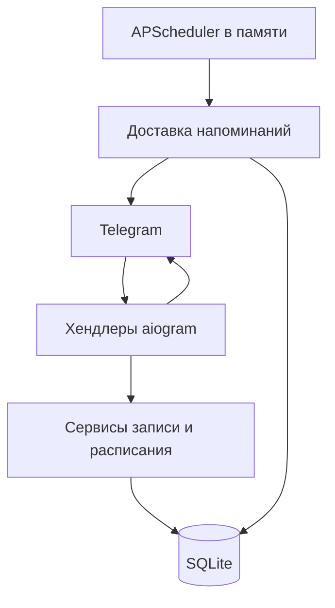

# Telegram-бот записи клиентов

[](https://github.com/Stephanchik/telegram-booking-bot/actions/workflows/ci.yml)
[](https://www.python.org/)
[](https://docs.aiogram.dev/)
[](LICENSE)

Бот для салона, барбершопа или частного специалиста. Клиент выбирает услугу, мастера, день и свободное время. Администратор ведёт расписание и записи в том же чате. Интерфейс на русском.

Один процесс, одна база SQLite, long polling. Так проще развернуть демо и не тащить лишнюю инфраструктуру.

## Возможности

Клиент:

- запись через inline-кнопки: услуга, специалист, календарь, свободное окно;
- подтверждение до того, как время станет занятым;
- свои будущие записи и отмена, если до визита ещё есть заданный запас времени;
- напоминания, по умолчанию за 24 часа и за 2 часа.

Администратор:

- услуги и специалисты, скрытие без удаления истории;
- неделя, выходные и особые часы на дату;
- записи на день и отмена с сообщением клиенту;
- текстовая рассылка;
- выгрузка CSV и Excel.

## Стек

Python 3.11+, aiogram 3, SQLAlchemy 2 async, Alembic, SQLite, APScheduler, pydantic-settings, Docker, pytest, ruff.

## Скриншоты

Кадры снимаются вручную по [docs/screenshots/README.md](docs/screenshots/README.md). В репозитории их пока нет, поэтому ниже список, а не картинки.

1. Главное меню.
2. Список услуг.
3. Календарь.
4. Свободное время.
5. Подтверждение.
6. Сообщение об успешной записи.
7. Мои записи.
8. Админ-панель.
9. Короткий GIF пути записи, когда он будет снят.

После съёмки вставьте сюда такой блок:

    
    
    
    
    
    
    
    

## Быстрый старт в Docker

Нужны Docker и токен BotFather.

```bash
cp .env.example .env
```

Откройте `.env`, впишите `BOT_TOKEN` и свой числовой id в `ADMIN_IDS`. Затем:

```bash
docker compose up -d --build
docker compose logs -f bot
```

В логе должна появиться строка со `username` бота. Остановка: `docker compose down`. База останется в каталоге `data/`.

Демо-каталог барбершопа «Норд»:

```bash
docker compose exec bot python -m booking_bot.seed
```

Повторный запуск сида ничего не дублирует.

Бот рассчитан на один контейнер. Второй процесс с тем же токеном и тем же файлом базы запускать нельзя: Telegram разорвёт polling, а SQLite не любит двух писателей.

## Локальный запуск

Python 3.11 или новее.

```bash
python -m venv .venv
source .venv/bin/activate
pip install -e ".[dev]"
cp .env.example .env
python -m booking_bot
```

Windows PowerShell:

```powershell
py -3.12 -m venv .venv
.\.venv\Scripts\Activate.ps1
pip install -e ".[dev]"
Copy-Item .env.example .env
python -m booking_bot
```

Проверки:

```bash
make lint
make test
```

Без make: `ruff check .`, `ruff format --check .`, `pytest -q`.

## Переменные окружения

Полный образец с комментариями лежит в [.env.example](.env.example). Обязателен только `BOT_TOKEN`. Часовой пояс по умолчанию `Europe/Moscow`. Напоминания по умолчанию за 24 часа и за 2 часа. Список админов — `ADMIN_IDS` через запятую. Смена списка требует перезапуска.

## Команды бота

| Команда | Кто | Что делает |
| --- | --- | --- |
| `/start` | все | главное меню, сброс незавершённого ввода |
| `/book` | все | запись |
| `/my` | все | свои записи |
| `/cancel` | все | бросить текущий ввод |
| `/admin` | админ | админ-панель |

## Архитектура



Запись создаётся в транзакции `BEGIN IMMEDIATE`: проверка пересечения и вставка происходят вместе. Напоминания лежат в таблице. Планировщик только будит процесс, а после рестарта таблица поднимает и просроченные, и будущие отправки.

Каталоги в коде:

- `src/booking_bot/bot` — хендлеры, клавиатуры, тексты;
- `src/booking_bot/services` — слоты, запись, напоминания, экспорт;
- `src/booking_bot/db` — модели и сессия;
- `alembic/versions` — схема.

## Данные

База хранит Telegram ID, имя, username, телефон, если клиент его отправил, и записи. Платёжных данных нет. Файл `data/booking.db` содержит персональные данные клиентов салона: его не коммитят и не прикладывают к issue.

Копия базы: остановить контейнер и скопировать файл. Копировать файл у работающего процесса можно, но остановка проще и надёжнее для демо.

## Разработка

Тесты покрывают расчёт окон, пересечение записей, отмену, план напоминаний, разбор телефона и цены, миграцию. Сеть Telegram тестам не нужна.

Новая таблица или колонка — новая ревизия Alembic после `20261124_0001`, а не правка уже выпущенной ревизии.

## Лицензия

MIT. См. [LICENSE](LICENSE).

Автор: [Stephanchik](https://github.com/Stephanchik).