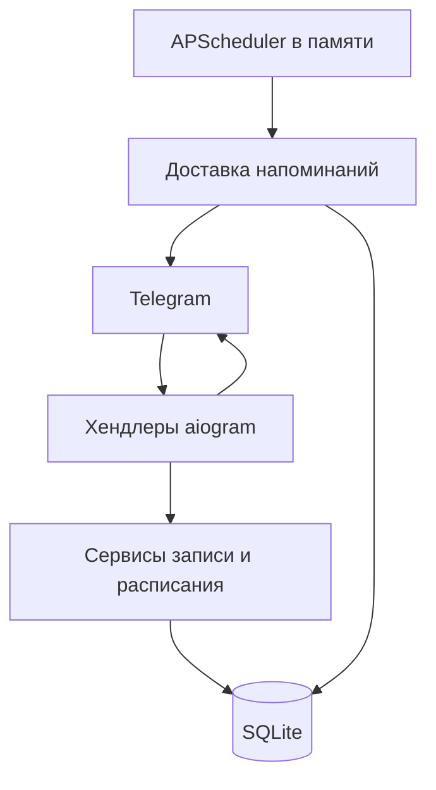

# План реализации: Telegram-бот записи клиентов

Статус: единственная спецификация. Кода приложения в репозитории ещё нет.
Исполнитель (следующая модель) реализует проект строго по этому документу и не принимает продуктовых решений.
Если какой-то текст интерфейса, имя файла, формат callback или правило здесь не описаны, брать формулировку из ближайшего пункта этого плана, а не придумывать новый сценарий.
Файл `docs/PLAN.md` в ходе реализации не переписывать.

Репозиторий: `https://github.com/Stephanchik/telegram-booking-bot`.
Автор портфолио: Стефан, GitHub `Stephanchik`.
Язык интерфейса бота: русский.
Язык идентификаторов, имён файлов, коммитов и полей логов: английский.
Версия продукта, которую должна получить реализация: `0.1.0`.

Документ закрывает все 13 обязательных разделов. Ниже они идут в порядке, удобном для реализации; оглавление совпадает с требованиями задачи.

## Оглавление

1. Цели, скоуп и вне скоупа
2. Зафиксированные решения
3. Дерево файлов
4. Зависимости, `pyproject.toml`, Makefile
5. Модель данных
6. Конфигурация и переменные окружения
7. Бизнес-правила: слоты, часовой пояс, конфликты, отмена, крайние случаи
8. Напоминания: планирование и восстановление после рестарта
9. Экраны, FSM, callback, клавиатуры, тексты
10. Админка и контроль доступа
11. Рассылка и экспорт
12. Логирование и жизненный цикл процесса
13. Сид демо-данных
14. Тесты
15. Docker
16. CI и линтеры
17. README и оформление репозитория
18. Пошаговый чеклист с критериями приёмки
19. Риски и открытые вопросы
20. Приложение A. Готовый текст `README.md`
21. Приложение B. Готовый `.env.example`
22. Приложение C. Готовые конфиги Docker, CI, ruff
23. Приложение D. Псевдокод критических функций

---

## 1. Цели, скоуп и вне скоупа

### 1.1. Цель

Собрать публичный портфолио-репозиторий, который клиент фрилансера открывает с GitHub и воспринимает как рабочий продуктовый проект, а не как учебную заготовку.

Продукт внутри репозитория: один Telegram-бот на одну организацию (салон, барбершоп, репетитор, кабинет). Клиент записывается на услугу к специалисту в свободное окно. Администратор ведёт каталог, расписание и записи из того же бота.

Демонстрационный бизнес в примерах и сиде: барбершоп «Норд». Название, адрес и телефон настоящие не зашивать: они приходят из окружения. В сиде и в `.env.example` используются вымышленные значения.

### 1.2. Что входит в версию 0.1.0

Клиент:

- главное меню;
- выбор активной услуги;
- выбор активного специалиста, который эту услугу оказывает и у которого есть хотя бы одно свободное окно в горизонте записи;
- календарь месяца и выбор дня;
- выбор свободного слота;
- экран подтверждения и создание записи;
- запрос телефона, если номера ещё нет и `REQUIRE_PHONE=true`;
- список своих записей и отмена по правилу дедлайна;
- напоминания до визита.

Администратор (Telegram ID из `ADMIN_IDS`):

- услуги: создать, изменить поля по одному, скрыть и снова показать;
- специалисты: создать, изменить имя и описание, скрыть и показать, включить и выключить услуги;
- недельное расписание интервалами, выходной на дату, свои часы на дату, возврат к недельному шаблону;
- записи на выбранный день и отмена с уведомлением клиента;
- текстовая рассылка всем, кто запускал бота и не заблокировал его;
- экспорт записей за период в CSV и XLSX.

Инженерия:

- Python 3.11+ (CI гоняет 3.11 и 3.12, Docker-образ на 3.12);
- aiogram 3, long polling;
- SQLite через SQLAlchemy 2 async и Alembic;
- APScheduler 3.11 `AsyncIOScheduler` в памяти процесса;
- источник истины напоминаний — таблица `reminders`, а не память планировщика;
- pydantic-settings и `.env.example`, секретов в git нет;
- JSON-логи в stdout;
- pytest на бизнес-логику;
- ruff format и ruff check;
- GitHub Actions;
- Dockerfile и docker-compose;
- README на русском с бейджами, списком возможностей, схемой и сценарием скриншотов.

### 1.3. Вне скоупа

Реализации этих пунктов в коде быть не должно. Не оставлять под них пустые модули, флаги и TODO.

- мультиарендность и несколько салонов в одной базе;
- веб-панель, Mini App, личный кабинет вне Telegram;
- оплата, предоплата, возвраты, ЮKassa и любые платёжные API;
- PostgreSQL, Redis, очереди, вебхуки, второй инстанс бота;
- роли кроме «админ по списку ID» и «все остальные»;
- отдельные команды бота для специалиста (мастер не получает свой интерфейс);
- ночные смены через полночь одним интервалом;
- перерывы внутри слота, сложные ресурсы (кресло, кабинет) отдельно от специалиста;
- синхронизация с Google Calendar;
- мультиязычность и gettext;
- вложения в рассылке: фото, видео, кнопки, форматирование;
- жесткое удаление услуг, специалистов и записей из интерфейса;
- перестановка услуг перетаскиванием;
- личный кабинет с редактированием имени;
- капча и антиспам сверх одного процесса;
- покрытие тестами транспортного слоя Telegram и снапшоты сообщений;
- mypy как обязательный шаг CI;
- порог coverage в CI;
- pinning Docker-образа по digest;
- автосъёмка скриншотов и генерация GIF в CI;
- резервное копирование как код (в README только инструкция);
- юридическая политика обработки ПДн отдельным документом (в README короткий абзац).

---

## 2. Зафиксированные решения

Исполнитель не пересматривает этот список.

1. Один процесс, один файл SQLite, один бот. Масштабирование репликами запрещено README и комментарием в `docker-compose.yml`.
2. Long polling. Вебхук не поднимать.
3. Все моменты времени в базе — timezone-aware UTC. Все календарные сутки, «сегодня» и подписи в сообщениях — в `BUSINESS_TIMEZONE` (IANA, по умолчанию `Europe/Moscow`). Перевод через `zoneinfo`. Библиотеку `pytz` не ставить.
4. Интервалы слотов полуоткрытые: `[start, end)`. Соседние записи `11:00–12:00` и `12:00–13:00` не конфликтуют.
5. Слоты выровнены по сетке от полуночи бизнес-суток: старт в минутах от полуночи делится на `SLOT_STEP_MINUTES`.
6. Слот целиком лежит внутри одного рабочего интервала и не перепрыгивает обеденный разрыв.
7. Буфер `BUFFER_MINUTES` (по умолчанию 0) обязателен с обеих сторон занятой записи. Формула в разделе 7.
8. Горизонт: клиент выбирает дату `D`, если `today <= D <= today + BOOKING_HORIZON_DAYS` включительно. `today` считается в бизнес-зоне. При значении 30 доступен сегодня и ещё 30 дней.
9. Минимальный зазор до старта записи `MIN_LEAD_MINUTES` (30). Слот со стартом ровно `now + lead` доступен. Сравнение в UTC.
10. Клиент отменяет подтверждённую запись, если `starts_at >= now + CANCEL_MIN_LEAD_MINUTES` (120). Граница включительно. Админ отменяет любую запись в статусе `confirmed`, в том числе уже начавшуюся.
11. Запись не удаляется. Меняется статус. Напоминания этой записи переводятся в `skipped`.
12. У услуги и специалиста нет hard delete в UI. Есть `is_active`. Прошлые записи хранят снимок названия, длительности и цены.
13. Один специалист не ведёт двух клиентов одновременно, даже по разным услугам. Один клиент может иметь пересекающиеся записи к разным специалистам: проверки на это нет.
14. Телефон по умолчанию обязателен (`REQUIRE_PHONE=true`), нормализуется в `+7XXXXXXXXXX`. Хранится на пользователе и переиспользуется.
15. Время не резервируется, пока клиент не нажал «Подтвердить». Гонка двух подтверждений решается транзакцией `BEGIN IMMEDIATE` и повторной проверкой.
16. Повторное подтверждение того же клиента на тот же старт к тому же специалисту возвращает уже созданную запись и показывает успех, а не ошибку.
17. FSM хранится в памяти (`MemoryStorage`). Параметры записи продублированы в callback и переживают рестарт. Текст, который админ ещё не отправил, после рестарта пропадает: это приемлемо и описано в текстах.
18. Планировщик APScheduler не использует SQLAlchemy jobstore. После рестарта дата-джобы поднимаются из таблицы `reminders`, а раз в `REMINDER_SWEEP_SECONDS` проходит страховочный обход.
19. Режим разбора текста по умолчанию у `Bot` не задаётся. HTML включается точечно. Рассылка уходит без parse mode.
20. Все подставляемые имена, описания, телефоны и текст рассылки экранируются, когда сообщение в HTML. В рассылке экранирование не нужно, потому что parse mode выключен.
21. Эмодзи в интерфейсе нет.
22. Секреты, токен и файл базы в git не попадают. В репозитории только `.env.example`.
23. Ожидаемые бизнес-результаты — это объекты `Result`, не исключения. Исключения остаются для сбоев SQLite, Telegram и ошибок программиста.
24. Обработчики не получают ORM-объекты. Сервисы возвращают frozen dataclass из `domain/views.py`.
25. Тесты не ходят в Telegram и не поднимают polling.
26. Коммиты реализации на английском, короткие, в повелительном наклонении. Версию не бампить выше `0.1.0`.

---

## 3. Дерево файлов

Корень после реализации. Существующие `LICENSE` и `.gitignore` остаются. `README.md` заменяется текстом из приложения A. `docs/PLAN.md` уже есть.

```text
.
├── .github/
│   └── workflows/
│       └── ci.yml                          # lint + pytest на Python 3.11 и 3.12
├── .env.example                            # образец окружения, без боевого токена
├── .gitignore                              # дополнить правилами data/ и *.db*
├── .python-version                         # одна строка: 3.12
├── Dockerfile
├── LICENSE                                 # уже есть, MIT, Copyright (c) 2026 Stephanchik
├── Makefile
├── README.md
├── alembic.ini
├── docker-compose.yml
├── pyproject.toml
├── alembic/
│   ├── env.py                              # async upgrade, URL из Settings
│   ├── script.py.mako                      # стандартный шаблон Alembic без правок логики
│   └── versions/
│       └── 20261124_0001_initial.py        # единственная ревизия 0.1.0
├── docs/
│   ├── PLAN.md                             # этот документ, не переписывать
│   └── screenshots/
│       └── README.md                       # сценарий ручной съёмки, без бинарников
├── src/
│   └── booking_bot/
│       ├── __init__.py                     # __version__ = "0.1.0"
│       ├── __main__.py                     # asyncio.run(run())
│       ├── main.py                         # сборка процесса: миграции, scheduler, polling
│       ├── config.py                       # Settings
│       ├── logging_setup.py                # JSON-форматтер и фильтр токена
│       ├── texts.py                        # все русские строки интерфейса
│       ├── bot/
│       │   ├── __init__.py                 # пустой
│       │   ├── factory.py                  # Bot, Dispatcher, подключение роутеров
│       │   ├── commands.py                 # set_my_commands
│       │   ├── helpers.py                  # edit_html, answer_html, clip, toast
│       │   ├── filters.py                  # IsAdmin, IsAdminCallbackAttempt
│       │   ├── callbacks.py                # все CallbackData
│       │   ├── states.py                   # все StatesGroup
│       │   ├── middlewares.py              # сессия и upsert пользователя
│       │   ├── keyboards.py                # все InlineKeyboardMarkup
│       │   └── handlers/
│       │       ├── __init__.py             # include order
│       │       ├── commands.py             # /start /cancel /book /my /admin
│       │       ├── booking.py              # услуга, специалист, календарь, слот, подтверждение
│       │       ├── phone.py                # ввод телефона
│       │       ├── my_bookings.py
│       │       ├── fallback.py
│       │       ├── errors.py
│       │       └── admin/
│       │           ├── __init__.py
│       │           ├── menu.py
│       │           ├── services.py
│       │           ├── specialists.py
│       │           ├── schedule.py
│       │           ├── day.py
│       │           ├── broadcast.py
│       │           └── export.py
│       ├── db/
│       │   ├── __init__.py                 # реэкспорт Base и session factory
│       │   ├── base.py                     # DeclarativeBase
│       │   ├── session.py                  # engine, pragmas, immediate_session
│       │   └── models.py                   # все таблицы
│       ├── domain/
│       │   ├── __init__.py
│       │   ├── enums.py                    # StrEnum статусов
│       │   ├── views.py                    # frozen dataclass для UI и экспорта
│       │   └── results.py                  # Result-типы сервисов
│       ├── services/
│       │   ├── __init__.py
│       │   ├── timeutils.py                # зона, локализация, подписи дат
│       │   ├── parsing.py                  # телефон, деньги, ЧЧ:ММ, даты, имена
│       │   ├── plurals.py                  # русские формы «час/часа/часов»
│       │   ├── schedule.py                 # resolve_intervals и запись расписания
│       │   ├── slots.py                    # generate_slots, conflicts
│       │   ├── booking.py                  # создать и отменить
│       │   ├── reminders.py                # план, claim, sweep
│       │   ├── catalog.py                  # услуги и специалисты
│       │   ├── export.py                   # CSV и XLSX
│       │   └── broadcast.py                # обход получателей
│       └── seed.py                         # python -m booking_bot.seed
└── tests/
    ├── conftest.py
    ├── unit/
    │   ├── test_settings.py
    │   ├── test_parsing.py
    │   ├── test_plurals.py
    │   ├── test_timeutils.py
    │   ├── test_schedule_resolve.py
    │   ├── test_slots.py
    │   ├── test_cancel_policy.py
    │   └── test_reminders.py
    └── integration/
        ├── test_booking_service.py
        ├── test_reminders_worker.py
        ├── test_export.py
        └── test_migrations.py
```

Назначение каждого файла совпадает с комментарием в дереве. Новых пакетов и файлов сверх дерева не создавать. `tests/__init__.py` не нужен.

Каждый модуль `src/` начинается с однострочного английского docstring и строки `from __future__ import annotations`.

---

## 4. Зависимости, `pyproject.toml`, Makefile

Версии проверены по PyPI на 2026-11-24. Ставить нижние границы, верхние не допускают следующую мажорную ветку.

Runtime:

- `aiogram>=3.34,<4`
- `sqlalchemy[asyncio]>=2.0.36,<2.2`
- `aiosqlite>=0.21,<1`
- `alembic>=1.16,<2`
- `pydantic>=2.10,<3`
- `pydantic-settings>=2.11,<3`
- `apscheduler>=3.11,<4`
- `openpyxl>=3.1.5,<4`

Dev extra `dev`:

- `pytest>=8.3,<9`
- `pytest-asyncio>=0.25,<2`
- `ruff>=0.9`

`structlog`, `pytz`, `redis`, `uvicorn`, `fastapi` не добавлять.

`pyproject.toml` копировать по смыслу дословно:

```toml
[build-system]
requires = ["setuptools>=75", "wheel"]
build-backend = "setuptools.build_meta"

[project]
name = "telegram-booking-bot"
version = "0.1.0"
description = "Telegram-бот записи клиентов на услуги"
readme = "README.md"
requires-python = ">=3.11"
license = { text = "MIT" }
authors = [{ name = "Stephanchik" }]
dependencies = [
  "aiogram>=3.34,<4",
  "sqlalchemy[asyncio]>=2.0.36,<2.2",
  "aiosqlite>=0.21,<1",
  "alembic>=1.16,<2",
  "pydantic>=2.10,<3",
  "pydantic-settings>=2.11,<3",
  "apscheduler>=3.11,<4",
  "openpyxl>=3.1.5,<4",
]

[project.optional-dependencies]
dev = [
  "pytest>=8.3,<9",
  "pytest-asyncio>=0.25,<2",
  "ruff>=0.9",
]

[project.scripts]
booking-bot = "booking_bot.main:main"

[tool.setuptools.packages.find]
where = ["src"]

[tool.pytest.ini_options]
asyncio_mode = "auto"
asyncio_default_fixture_loop_scope = "function"
testpaths = ["tests"]

[tool.ruff]
target-version = "py311"
line-length = 100
src = ["src", "tests", "alembic"]

[tool.ruff.lint]
select = ["E", "F", "I", "UP", "B", "SIM", "ASYNC", "RUF"]

[tool.ruff.lint.per-file-ignores]
"alembic/versions/*.py" = ["E501"]

[tool.ruff.format]
quote-style = "double"
```

`src/booking_bot/__init__.py`:

```python
"""Telegram booking bot."""

__version__ = "0.1.0"
```

`main()` в `main.py` синхронная: внутри `asyncio.run(run())`. Так работает и `python -m booking_bot`, и console script.

Makefile, табы обязательны:

```makefile
.PHONY: install format lint test run seed

install:
	pip install -e ".[dev]"

format:
	ruff format .
	ruff check --fix .

lint:
	ruff check .
	ruff format --check .

test:
	pytest

run:
	python -m booking_bot

seed:
	python -m booking_bot.seed
```

---

## 5. Модель данных

Один модуль `src/booking_bot/db/models.py`. Стиль SQLAlchemy 2.0 `Mapped` и `mapped_column`. Enum в базе не использовать: колонка `String` плюс `CheckConstraint`, чтобы SQLite и Alembic не расходились. Значения enum дублируются в `domain/enums.py` как `enum.StrEnum`.

Общие правила колонок:

- первичный ключ `id: int`, автоинкремент, кроме таблицы связи многие-ко-многим;
- `created_at` и `updated_at`: `DateTime(timezone=True)`, не null, значение ставит приложение как `datetime.now(timezone.utc)` в репозитории, не `server_default`;
- булевы поля не null, default в Python `False` или `True` как указано;
- строки обрезает приложение до лимита колонки до INSERT;
- внешние ключи включены только если на соединении выполнен `PRAGMA foreign_keys=ON` (раздел 12).

### 5.1. `users`

Человек, который написал боту.

| Колонка | Тип | Ограничения |
| --- | --- | --- |
| `id` | Integer | PK |
| `telegram_id` | BigInteger | NOT NULL, UNIQUE `uq_users_telegram_id` |
| `username` | String(32) | NULL, без символа `@` |
| `full_name` | String(255) | NOT NULL |
| `phone` | String(16) | NULL, формат `+7` и 10 цифр |
| `is_blocked` | Boolean | NOT NULL, default false |
| `created_at` | DateTime(tz) | NOT NULL |
| `updated_at` | DateTime(tz) | NOT NULL |

Индекс `ix_users_is_blocked` на `is_blocked`.

`is_blocked=true` означает, что последняя отправка получила запрет или «чат не найден». Входящее сообщение от этого пользователя снова ставит `false`.

### 5.2. `services`

| Колонка | Тип | Ограничения |
| --- | --- | --- |
| `id` | Integer | PK |
| `name` | String(80) | NOT NULL |
| `description` | Text | NULL, в view пустая строка |
| `duration_minutes` | Integer | NOT NULL, check `ck_services_duration`: `duration_minutes >= 5 AND duration_minutes <= 480` |
| `price_minor` | Integer | NOT NULL, check `ck_services_price`: `price_minor >= 0`. Копейки. 1500 рублей = `150000` |
| `is_active` | Boolean | NOT NULL, default true |
| `sort_order` | Integer | NOT NULL, default 0 |
| `created_at`, `updated_at` | DateTime(tz) | NOT NULL |

Индекс `ix_services_active_sort` на `(is_active, sort_order, id)`.

Уникальность имени в базе не делать: SQLite сравнивает Unicode без casefold. Уникальность обеспечивает сервис: отказ, если уже есть строка с тем же `name.casefold().strip()`, включая скрытые.

### 5.3. `specialists`

| Колонка | Тип | Ограничения |
| --- | --- | --- |
| `id` | Integer | PK |
| `name` | String(80) | NOT NULL |
| `bio` | Text | NULL |
| `is_active` | Boolean | NOT NULL, default true |
| `sort_order` | Integer | NOT NULL, default 0 |
| `created_at`, `updated_at` | DateTime(tz) | NOT NULL |

Индекс `ix_specialists_active_sort` на `(is_active, sort_order, id)`.

Уникальность имени — та же проверка casefold в сервисе, текст «Специалист с таким именем уже есть.»

### 5.4. `specialist_services`

Связь специалиста и услуги. Составной PK `(specialist_id, service_id)`.

- `specialist_id` FK `specialists.id` `ON DELETE CASCADE`
- `service_id` FK `services.id` `ON DELETE CASCADE`
- индекс `ix_specialist_services_service_id` на `service_id`

Интерфейс строки не удаляет, CASCADE нужен схеме на будущее.

### 5.5. `work_intervals`

Недельный шаблон. Минуты от полуночи, чтобы не возить `Time` через SQLite.

| Колонка | Тип | Ограничения |
| --- | --- | --- |
| `id` | Integer | PK |
| `specialist_id` | Integer | NOT NULL, FK `specialists.id` `ON DELETE CASCADE` |
| `weekday` | SmallInteger | NOT NULL, check `ck_work_intervals_weekday`: `weekday >= 0 AND weekday <= 6`. 0 = понедельник, как `date.weekday()` |
| `start_minute` | SmallInteger | NOT NULL |
| `end_minute` | SmallInteger | NOT NULL |
| `created_at` | DateTime(tz) | NOT NULL |

Check `ck_work_intervals_bounds`: `start_minute >= 0 AND end_minute <= 1440 AND start_minute < end_minute`.

`end_minute = 1440` означает границу 24:00 и допустим только как конец. Старт 1440 запрещён неравенством.

Индекс `ix_work_intervals_specialist_weekday` на `(specialist_id, weekday)`.

Пересечение интервалов одного дня не пускать в сервисе. Касание `10:00–14:00` и `14:00–18:00` разрешено: пересечение это `a_start < b_end and b_start < a_end`.

### 5.6. `schedule_overrides`

Исключение на календарную дату бизнес-зоны.

| Колонка | Тип | Ограничения |
| --- | --- | --- |
| `id` | Integer | PK |
| `specialist_id` | Integer | NOT NULL, FK CASCADE |
| `work_date` | Date | NOT NULL |
| `kind` | String(16) | NOT NULL, check `ck_schedule_overrides_kind`: `kind IN ('day_off', 'custom')` |
| `created_at` | DateTime(tz) | NOT NULL |

UNIQUE `uq_schedule_overrides_specialist_date` на `(specialist_id, work_date)`.

`day_off`: интервалов-детей нет, день закрыт.
`custom`: недельный шаблон на эту дату игнорируется, действуют только детские интервалы. Если последний детский интервал удалили, удалить и override, чтобы снова действовала неделя. Это делает сервис.

### 5.7. `schedule_override_intervals`

| Колонка | Тип | Ограничения |
| --- | --- | --- |
| `id` | Integer | PK |
| `override_id` | Integer | NOT NULL, FK `schedule_overrides.id` `ON DELETE CASCADE` |
| `start_minute` | SmallInteger | NOT NULL |
| `end_minute` | SmallInteger | NOT NULL |

Тот же check границ, имя `ck_override_intervals_bounds`.
Индекс `ix_schedule_override_intervals_override_id` на `override_id`.

Для `kind=day_off` сервис не вставляет детей и удаляет старых при переключении.

### 5.8. `bookings`

| Колонка | Тип | Ограничения |
| --- | --- | --- |
| `id` | Integer | PK. Это «номер записи» в текстах |
| `client_id` | Integer | NOT NULL, FK `users.id` `ON DELETE RESTRICT` |
| `specialist_id` | Integer | NOT NULL, FK `specialists.id` `ON DELETE RESTRICT` |
| `service_id` | Integer | NOT NULL, FK `services.id` `ON DELETE RESTRICT` |
| `service_name` | String(80) | NOT NULL, снимок |
| `specialist_name` | String(80) | NOT NULL, снимок |
| `price_minor` | Integer | NOT NULL, снимок, `>= 0` check `ck_bookings_price` |
| `duration_minutes` | Integer | NOT NULL, снимок |
| `starts_at` | DateTime(tz) | NOT NULL, UTC |
| `ends_at` | DateTime(tz) | NOT NULL, UTC |
| `status` | String(32) | NOT NULL |
| `cancel_reason` | Text | NULL |
| `created_at` | DateTime(tz) | NOT NULL |
| `cancelled_at` | DateTime(tz) | NULL |
| `cancelled_by_telegram_id` | BigInteger | NULL |

Check `ck_bookings_time`: `ends_at > starts_at`.
Check `ck_bookings_status`: `status IN ('confirmed', 'cancelled_by_client', 'cancelled_by_admin')`.

Индексы:

- `ix_bookings_specialist_status_start` на `(specialist_id, status, starts_at)`
- `ix_bookings_client_start` на `(client_id, starts_at)`
- `ix_bookings_starts_at` на `(starts_at)`

Статусы:

- `confirmed` — действующая запись, в том числе после того как визит уже прошёл;
- `cancelled_by_client`;
- `cancelled_by_admin`.

Отдельного статуса `completed` нет. «Состоялась» и «идёт» вычисляются из `status`, `starts_at`, `ends_at` и текущего времени.

### 5.9. `reminders`

| Колонка | Тип | Ограничения |
| --- | --- | --- |
| `id` | Integer | PK |
| `booking_id` | Integer | NOT NULL, FK `bookings.id` `ON DELETE CASCADE` |
| `offset_minutes` | Integer | NOT NULL, check `ck_reminders_offset`: `offset_minutes > 0` |
| `fire_at` | DateTime(tz) | NOT NULL, UTC, равно `starts_at - offset` |
| `status` | String(16) | NOT NULL |
| `sent_at` | DateTime(tz) | NULL |
| `attempt_count` | Integer | NOT NULL, default 0 |
| `last_error` | String(500) | NULL |

Check `ck_reminders_status`: `status IN ('pending', 'sending', 'sent', 'skipped', 'failed')`.
UNIQUE `uq_reminders_booking_offset` на `(booking_id, offset_minutes)`.
Индекс `ix_reminders_status_fire_at` на `(status, fire_at)`.

### 5.10. `broadcasts`

| Колонка | Тип | Ограничения |
| --- | --- | --- |
| `id` | Integer | PK |
| `admin_telegram_id` | BigInteger | NOT NULL |
| `text` | Text | NOT NULL |
| `created_at` | DateTime(tz) | NOT NULL |
| `finished_at` | DateTime(tz) | NULL, пока рассылка не закончилась или не признана прерванной |
| `total` | Integer | NOT NULL, default 0 |
| `sent` | Integer | NOT NULL, default 0 |
| `failed` | Integer | NOT NULL, default 0 |
| `blocked` | Integer | NOT NULL, default 0 |

Индекс `ix_broadcasts_created_at` на `created_at`.

### 5.11. Связи ORM

- `User.bookings`
- `Specialist.services` через `specialist_services`, `Service.specialists` обратно
- `Specialist.intervals`, `Specialist.overrides`
- `ScheduleOverride.intervals`
- `Booking.client`, `Booking.specialist`, `Booking.service`, `Booking.reminders`

Для чтения override сразу грузить интервалы через `selectinload`. Ленивые async-обращения из обработчиков запрещены: наружу уходят только view.

### 5.12. View и результаты

`domain/views.py`, все dataclass frozen.

`ServiceView`: `id, name, description, duration_minutes, price_minor, is_active, sort_order`. `description` всегда `str`, NULL из базы становится `""`.

`SpecialistView`: `id, name, bio, is_active, sort_order`. `bio` всегда `str`.

`IntervalView`: `id, weekday, start_minute, end_minute`.

`OverrideView`: `id, work_date, kind, intervals: tuple[tuple[int, int], ...]`.

`BookingView`: поля таблицы плюс `client_telegram_id: int`, `client_name: str`, `client_username: str | None`, `client_phone: str | None`.

`UserView`: `id, telegram_id, username, full_name, phone, is_blocked`.

`domain/results.py`:

```python
@dataclass(frozen=True)
class BookingResult:
    kind: str  # created, exists, conflict, unavailable, not_in_schedule, too_soon
    booking: BookingView | None = None

@dataclass(frozen=True)
class CancelResult:
    kind: str  # cancelled, already, not_found, too_late
    booking: BookingView | None = None
```

Сервис отмены не шлёт Telegram и не возвращает флаг доставки. После `kind=cancelled` обработчик сам шлёт уведомление и при ошибке дописывает `T_ADMIN_CANCEL_NOTIFY_FAILED`.

`ReminderPlan`: `tuple[tuple[int, datetime], ...]` — пары `(offset_minutes, fire_at)`.

### 5.13. Миграция

Ревизия `20261124_0001` , `down_revision = None`. Имя файла `alembic/versions/20261124_0001_initial.py`.

`upgrade` создаёт таблицы в порядке: `users`, `services`, `specialists`, `specialist_services`, `work_intervals`, `schedule_overrides`, `schedule_override_intervals`, `bookings`, `reminders`, `broadcasts`.
`downgrade` удаляет в обратном порядке.

`alembic/env.py`:

- в `sys.path` добавляется `src`, если запуск не из установленного пакета;
- импортируются модели, чтобы заполнился `Base.metadata`;
- URL берётся из `Settings().database_url`, значение `sqlalchemy.url` из ini игнорируется;
- online-режим через `async_engine_from_config` и `connection.run_sync(context.run_migrations)`;
- обёртка верхнего уровня вызывает `asyncio.run`, чтобы `command.upgrade` из синхронного теста не требовал уже запущенного цикла.

`alembic.ini`: `script_location = alembic`, `prepend_sys_path = src`, `sqlalchemy.url = sqlite+aiosqlite:///./data/booking.db` как заглушка. `version_path_separator = os`. Файл шаблона оставить стандартным, который генерирует Alembic 1.20.

Тест `tests/integration/test_migrations.py` синхронный (`def`, не `async def`): на временной базе `alembic upgrade head`, затем `sqlalchemy.inspect` содержит ровно эти имена таблиц плюс `alembic_version`, и каждое имя из `Base.metadata.tables` присутствует. Обратное тоже проверить: лишних таблиц приложения нет.

---

## 6. Конфигурация и переменные окружения

Класс `Settings(BaseSettings)` в `config.py`.

```python
model_config = SettingsConfigDict(
    env_file=".env",
    env_file_encoding="utf-8",
    extra="ignore",
    case_sensitive=False,
)
```

| Переменная | Поле | Тип | По умолчанию | Правило |
| --- | --- | --- | --- | --- |
| `BOT_TOKEN` | `bot_token` | str | нет, обязательна | длина от 20, есть символ `:`, нет пробелов |
| `ADMIN_IDS` | `admin_ids_raw` | str | `""` | список целых через запятую; пустые куски игнорировать; любой нецелый фрагмент роняет старт |
| `BUSINESS_NAME` | `business_name` | str | `Барбершоп «Норд»` | после strip длина 1..80 |
| `BUSINESS_TIMEZONE` | `business_timezone` | str | `Europe/Moscow` | конструктор `ZoneInfo` обязан успеть, иначе ошибка настроек |
| `BUSINESS_ADDRESS` | `business_address` | str | `""` | strip, максимум 200, иначе ошибка настроек |
| `BUSINESS_PHONE` | `business_phone` | str | `""` | как есть после strip, максимум 32; это текст для клиента, не нормализованный телефон |
| `DATABASE_URL` | `database_url` | str | `sqlite+aiosqlite:///./data/booking.db` | должен начинаться с `sqlite+aiosqlite://` |
| `SLOT_STEP_MINUTES` | `slot_step_minutes` | int | `30` | 5..180 и кратно 5 |
| `BUFFER_MINUTES` | `buffer_minutes` | int | `0` | 0..180 |
| `MIN_LEAD_MINUTES` | `min_lead_minutes` | int | `30` | 0..10080 |
| `CANCEL_MIN_LEAD_MINUTES` | `cancel_min_lead_minutes` | int | `120` | 0..10080 |
| `BOOKING_HORIZON_DAYS` | `booking_horizon_days` | int | `30` | 1..365 |
| `REMINDER_HOURS` | `reminder_hours` | str | `24,2` | целые часы 1..168 через запятую; пустые куски игнорировать; дубликаты убрать; после разбора список не может быть пустым |
| `REMINDER_SWEEP_SECONDS` | `reminder_sweep_seconds` | int | `60` | 15..3600 |
| `REQUIRE_PHONE` | `require_phone` | bool | `true` | pydantic bool |
| `LOG_LEVEL` | `log_level` | str | `INFO` | одно из `DEBUG`, `INFO`, `WARNING`, `ERROR` |
| `LOG_JSON` | `log_json` | bool | `true` | |
| `AUTO_MIGRATE` | `auto_migrate` | bool | `true` | перед polling выполнить `alembic upgrade head` |

Свойства:

- `admin_ids: tuple[int, ...]` в порядке из env, без дубликатов, только положительные. `0` и отрицательные — ошибка настроек.
- `reminder_offsets_minutes: tuple[int, ...]` часы по убыванию, умноженные на 60. Для значения по умолчанию `(1440, 120)`.
- `zone: ZoneInfo`.

Ошибки валидации пробрасывать как `ValidationError` pydantic на старте. Процесс завершается с кодом 1, в лог пишется текст ошибки без токена.

Готовый `.env.example` — приложение B. Реальный `.env` в git не добавлять.

Каталог файла SQLite создавать на старте, если URL файловый. Разбор:

- `sqlite+aiosqlite:///./data/booking.db` → относительный путь `data/booking.db`;
- `sqlite+aiosqlite:////absolute/booking.db` → абсолютный путь;
- `:memory:` не создавать.

Функция `sqlite_path(url: str) -> Path | None` живёт в `db/session.py` и покрыта тестом в `test_settings.py` (три случая выше).

---

## 7. Бизнес-правила

### 7.1. Часовой пояс

Функции времени лежат в `services/timeutils.py` и не читают `datetime.now` сами. Текущий момент передаёт вызывающий.

- `now_utc()` допускается только в `main.py`, middleware и обработчиках. Сервисы получают `now: datetime`.
- Наивный datetime в сервисы не передавать. Если пришёл, бросить `ValueError`.
- `to_local(utc, zone) -> datetime`.
- `local_day_bounds(day, zone) -> tuple[datetime, datetime]` — UTC-границы локальных суток `[start, next_midnight)`.
- `localize(day, minute, zone) -> datetime | None`. Минута 1440 — это следующие локальные сутки 00:00. Иначе `hour, minute = divmod(minute, 60)`, собрать наивный datetime, повесить `tzinfo=zone` с `fold=0`. Если обратная конвертация в UTC и снова в зону не совпала со стеной часов, вернуть `None` (весенний пропуск). Осеннюю неоднозначность оставлять как fold=0, она проходит round-trip.
- Подписи:
  - месяцы именительный: январь, февраль, март, апрель, май, июнь, июль, август, сентябрь, октябрь, ноябрь, декабрь;
  - месяцы родительный: января, февраля, марта, апреля, мая, июня, июля, августа, сентября, октября, ноября, декабря;
  - дни: понедельник, вторник, среда, четверг, пятница, суббота, воскресенье;
  - короткие: Пн Вт Ср Чт Пт Сб Вс;
  - `format_day(local) -> "вторник, 24 ноября 2026"` — день недели строчными;
  - `format_short_day(local) -> "вт, 24 ноября 2026"`;
  - `format_hhmm(minute) -> "09:05"` всегда с ведущим нулём, 1440 не форматировать этой функцией;
  - диапазон часов `14:30–15:30` с коротким тире `–` (U+2013);
  - если локальные даты начала и конца различаются, `format_span` пишет обе даты. При текущих правилах расписания это не случается, ветка всё равно есть.

Деньги, `services/parsing.py`, функция `format_price(price_minor: int) -> str`:

- `0` → `бесплатно`;
- копейки нулевые → `1 500 ₽` (пробел между тысячами, обычный пробел U+0020);
- иначе → `1 500,50 ₽`.

Телефон в текстах, `format_phone(stored: str) -> str`: `+7 999 123-45-67`. Если строка не из 12 символов `+7` и 10 цифр, вернуть как есть.

### 7.2. Разрешение интервалов дня

`resolve_intervals(*, weekday, weekly, override_kind, override_intervals) -> list[tuple[int, int]]` в `services/schedule.py`. Функция чистая.

- `override_kind == "day_off"` → пустой список;
- `override_kind == "custom"` → интервалы исключения, отсортированные по старту;
- `override_kind is None` → интервалы недели с этим `weekday`, отсортированные по старту.

Неделя передаётся уже отфильтрованной по специалисту. Функция специалистом не интересуется.

### 7.3. Генерация слотов

`generate_slots` в `services/slots.py`. Чистая. Сигнатура:

```python
def generate_slots(
    *,
    day: date,
    intervals: Sequence[tuple[int, int]],
    duration_minutes: int,
    step_minutes: int,
    busy: Sequence[tuple[datetime, datetime]],
    buffer_minutes: int,
    zone: ZoneInfo,
    now: datetime,
    min_lead_minutes: int,
) -> list[Slot]:
```

`Slot` frozen: `start: datetime` (UTC), `end: datetime` (UTC), `start_minute: int`.

Алгоритм:

1. `min_start = now + timedelta(minutes=min_lead_minutes)`.
2. Для каждого интервала `(start_minute, end_minute)`:
   - `cursor = start_minute`;
   - если `cursor % step_minutes != 0`, поднять cursor до следующего кратного: `cursor += step_minutes - cursor % step_minutes`;
   - пока `cursor + duration_minutes <= end_minute`:
     - `start_local = localize(day, cursor, zone)`;
     - `end_local = localize(day, cursor + duration_minutes, zone)`;
     - запомнить cursor и сразу увеличить его на `step_minutes`;
     - если `start_local` или `end_local` это `None`, слот пропустить (несуществующее местное время);
     - перевести оба конца в UTC;
     - если `start_utc < min_start`, пропустить;
     - если `conflicts(...)`, пропустить;
     - иначе добавить `Slot`.
3. Отсортировать по `start`.
4. Удалить дубликаты с тем же `start`, оставить первый.

Рядом живёт чистая `slot_in_schedule(*, day, intervals, duration_minutes, step_minutes, minute, zone) -> bool`. Она истинна, когда `minute` совпадает с курсором цикла генератора, `minute + duration <= end` какого-то одного интервала, и оба конца локализуются. Lead, busy и buffer она не смотрит. `generate_slots` считает слот кандидатом только если `slot_in_schedule` истинна для его минуты. Отдельный проход «с пустым busy» не делать.

Конфликт:

```python
def conflicts(start, end, busy, buffer_minutes) -> bool:
    buf = timedelta(minutes=buffer_minutes)
    for busy_start, busy_end in busy:
        if start < busy_end + buf and end + buf > busy_start:
            return True
    return False
```

Занятые интервалы — только `status=confirmed` этого специалиста, без фильтра по услуге. Окно выборки из базы: `starts_at < day_end_utc + buffer` и `ends_at > day_start_utc - buffer`, где границы суток локальные. Так в день попадает запись, начавшаяся вчера, и буфер у края суток.

Примеры, которые тесты проверяют числами. Зона `Europe/Moscow`.

Пример A. День `2026-11-24`, интервал `600..720` (10:00–12:00), длительность 60, шаг 30, буфер 0, `now = 2026-11-24T06:00:00Z` (09:00 МСК), lead 30. Старты: 10:00, 10:30, 11:00. UTC: `07:00Z`, `07:30Z`, `08:00Z`. 11:30 не входит, потому что конец 12:30 позже границы.

Пример B. Те же условия, занято 10:30–11:30 МСК. Свободных слотов нет: каждый из трёх пересекает занятое.

Пример C. Занято 10:00–11:00, буфер 0. Свободен только 11:00–12:00.

Пример D. Интервал 10:00–14:00 (`600..840`), длительность 60, шаг 30, буфер 15, занято 10:00–11:00. Свободные старты: 11:30, 12:00, 12:30, 13:00. 11:00 отвергнут, потому что `11:00 < 11:15`.

Пример E. Интервалы `(600, 840)` и `(900, 1200)`, длительность 90, шаг 30, занятых нет, `now` далеко в прошлом, lead 0. Утренние старты: 10:00, 10:30, 11:00, 11:30, 12:00, 12:30. Следующий допустимый старт 15:00. 13:00 и 13:30 и 14:00 и 14:30 отсутствуют.

Пример F, весна, `America/New_York`, день `2026-03-08`, интервал `(0, 240)`, длительность 30, шаг 30, lead 0, `now` равен `2026-03-07T00:00:00Z`. Стартовые минуты ровно `{0, 30, 60, 180, 210}`. Минуты 90, 120, 150 отсутствуют: слот 01:30 кончается в несуществующие 02:00, сами 02:00 и 02:30 не существуют. 03:00 локально равно `2026-03-08T07:00:00Z`.

Пример G, осень, `America/New_York`, день `2026-11-01`, интервал `(0, 240)`, длительность 30, шаг 30, lead 0, `now` в прошлом. Слотов 8, стартовые минуты уникальны: 0, 30, 60, 90, 120, 150, 180, 210. Слот минуты 90 (01:30) имеет UTC `2026-11-01T05:30:00Z` (fold=0, первое наступление, EDT, UTC−4).

### 7.4. Какие дни и специалисты показывать

`booking_window(now, zone, horizon_days) -> tuple[date, date]` возвращает `(today, today + horizon_days)`.

Специалист попадает в список услуги, если одновременно:

- услуга `is_active`;
- специалист `is_active`;
- связь в `specialist_services` есть;
- в окне горизонта есть хотя бы один свободный слот этой длительности.

Если активных услуг нет: текст `T_NO_SERVICES`.
Если услуга исчезла или скрыта между экранами: toast `T_SERVICE_GONE`.
Если специалистов с окнами нет: `T_NO_SPECIALISTS`.

Календарь на месяц строится `calendar.Calendar(firstweekday=0)`. Клетка вне месяца — кнопка `·` с callback `noop`. Клетка внутри месяца всегда `DayCD`, даже если день пустой, прошедший или за горизонтом. Решение принимает обработчик дня:

- дата `< today` → toast `T_TOAST_PAST`, сообщение не менять;
- дата `> max_date` → toast `T_TOAST_FUTURE`;
- свободных слотов нет → toast `T_TOAST_NO_SLOTS_DAY`;
- иначе редактировать сообщение в список слотов, страница 0.

Стрелка месяца назад, если целевой месяц раньше месяца `today`: toast `T_TOAST_MONTH_EARLY`, экран не менять.
Стрелка вперёд, если первое число целевого месяца больше `max_date`: toast `T_TOAST_MONTH_LATE`.

Список слотов: по 12 штук на страницу, 3 в ряд. Порядок хронологический. Подпись кнопки `format_hhmm(start_minute)`.

### 7.5. Создание записи

`BookingService.create` открывает `immediate_session()` и делает всё ниже в одной транзакции `BEGIN IMMEDIATE`. После выхода из контекста соединение закрыто, наружу уходит `BookingResult` со `BookingView`, собранным до закрытия сессии.

Телефон в эту транзакцию не писать. Его сохраняет отдельная короткая транзакция до вызова `create`, см. раздел 9.8. Отказ слота телефон не откатывает.

Порядок внутри транзакции:

1. Прочитать услугу, специалиста и связь. Нет строки, кто-то неактивен или связи нет → `unavailable`.
2. Разобрать `ymd` и `minute`. Минута вне `0..1439`, дата не разбирается или `localize` старта либо конца вернул `None` → `not_in_schedule`. Конец = старт + живая `duration_minutes` услуги.
3. Локальная дата вне окна `booking_window` → `not_in_schedule`.
4. Найти подтверждённую запись того же `client_id`, того же `specialist_id` и того же `starts_at`. Если есть → `exists` и эта запись.
5. `slot_in_schedule` ложь → `not_in_schedule`.
6. `start < now + lead` → `too_soon`.
7. Пересечение с чужой подтверждённой записью → `conflict`. Предикат один, тот же что у `conflicts`, и он же в SQL:

```sql
SELECT id FROM bookings
WHERE specialist_id = :sid
  AND status = 'confirmed'
  AND starts_at < :end_plus_buffer
  AND ends_at > :start_minus_buffer
LIMIT 1
```

`end_plus_buffer = end + buffer`, `start_minus_buffer = start - buffer`. Нашлась строка → `conflict`. Вторую проверку через `generate_slots` не делать: сетку уже проверил `slot_in_schedule`, занятость проверяет этот SQL.

8. Вставить `bookings` со снимками `service_name`, `specialist_name`, `price_minor`, `duration_minutes` из только что прочитанных строк. `status=confirmed`.
9. Построить план напоминаний и вставить строки `pending`.
10. Commit. View собрать до закрытия сессии.

Гонка двух транзакций: вторая блокируется на `BEGIN IMMEDIATE`, после коммита первой видит пересечение и возвращает `conflict`. Повтор той же кнопки тем же клиентом на шаге 4 возвращает `exists`.

Снимок не переписывать, если админ позже переименует услугу. Тест это фиксирует.

### 7.6. Отмена

```python
def can_client_cancel(*, status: str, starts_at: datetime, now: datetime, cancel_min_lead_minutes: int) -> bool:
    if status != "confirmed":
        return False
    return starts_at >= now + timedelta(minutes=cancel_min_lead_minutes)
```

Граница: разница ровно `cancel_min_lead_minutes` разрешает отмену. На секунду меньше — запрещает. Прошедший старт запрещает.

`can_admin_cancel(status) -> bool` истинно только для `confirmed`. Время не важно.

`BookingService.cancel_by_client` в `immediate_session`:

- чужой `client_id` или нет строки → `not_found` (существование чужой записи не подтверждать);
- статус уже не `confirmed` → `already`;
- `can_client_cancel` ложь → `too_late`, строку не менять;
- иначе статус `cancelled_by_client`, `cancelled_at=now`, `cancelled_by_telegram_id` клиента, `cancel_reason="Отменено клиентом"`, все напоминания этой записи со статусом `pending` или `sending` стать `skipped`, `last_error="booking_cancelled"`.

`cancel_by_admin`:

- нет строки → `not_found`;
- уже не `confirmed` → `already`;
- иначе `cancelled_by_admin`, причина ровно `Отменено администратором`, `cancelled_by_telegram_id` админа, напоминания так же `skipped`.

Уведомления отправлять после коммита. Неудача уведомления отмену не откатывает.

После отмены слот сразу снова свободен, потому что выборка занятых смотрит только `confirmed`.

### 7.7. Крайние случаи

- Длительность больше любого интервала: слотов нет, клиент видит пустой день и toast.
- Шаг больше интервала и ни один выровненный старт не помещается: слотов нет.
- `BUFFER_MINUTES > 0` не сдвигает границы рабочего дня. Слот может начинаться ровно в открытие.
- Выходной поверх недели даёт пустой день даже если недельный шаблон полный.
- `custom` с интервалами заменяет неделю, а не дополняет её.
- Удаление последнего custom-интервала удаляет override.
- Скрытие услуги или специалиста не отменяет будущие записи. В карточке админа, если будущих `confirmed` с этим id больше нуля, показать фразу с числом. Записи остаются.
- Изменение длительности или цены не двигает существующие `starts_at` и `ends_at`.
- Клиент без username отображается как имя и слова `без username`.
- Пустое имя Telegram заменяется на `Клиент` при upsert, обрезание `full_name` до 255, `username` до 32.
- Двойной клик «Подтвердить» обрабатывается веткой `exists`.
- Кнопка со старым callback после удаления данных: toast `T_STALE`.
- Неизвестный префикс или action: toast `T_STALE`.
- Чат не `private`: апдейт игнорируется без ответа. Фильтр на message и callback_query: `F.chat.type == "private"`.
- Групповые апдейты и `my_chat_member` в список `allowed_updates` не входят. В polling передать `dp.resolve_used_update_types()`.
- Расписание с пересечением админ сохранить не может.
- Интервал через полночь одной строкой запрещён. Текст говорит разбить на два дня. Вторую строку админ заводит сам, если она нужна; автоматического разбиения нет.
- Повторный `/start` сбрасывает FSM и показывает главное меню. Черновик телефона теряется. Кнопка «Подтвердить» в истории чата по-прежнему содержит все id и создаёт запись заново, снова спросив телефон, если его нет.
- `SEED` не запускается сам при старте бота.

---

## 8. Напоминания

### 8.1. План

`plan_reminders(*, starts_at, now, offsets_minutes) -> list[tuple[int, datetime]]` чистая, в `services/reminders.py`.

Для каждого offset по убыванию:

- `fire_at = starts_at - timedelta(minutes=offset)`;
- если `fire_at <= now`, пару не включать;
- иначе включить.

Запись через 3 суток и offsets `(1440, 120)` даёт обе пары.
Запись через 3 часа даёт только `(120, starts_at-2h)`.
Запись через 30 минут при этих offsets даёт пустой план.
`fire_at` всегда строго равен разности, без дрожания секунд: тест сравнивает равенство.

При вставке записи вставить все пары со статусом `pending`, `attempt_count=0`.

### 8.2. Что говорить в напоминании

Функция `reminder_text(...)` в `texts.py`. Выбор шаблона по времени отправки `sent_at`, а не по имени offset:

- если локальная дата визита равна локальной дате отправки и `starts_at > sent_at` и разница не больше 3 часов — шаблон «сегодня»;
- иначе если локальная дата визита равна завтра относительно `sent_at` и offset не меньше 20 часов — шаблон «завтра»;
- иначе общий шаблон.

Тексты — в каталоге `T_REM_*`. Имена услуги и специалиста в HTML экранируются.

### 8.3. Захват и отправка

Статусы: `pending` → `sending` → `sent` либо назад в `pending` / `failed` / `skipped`.

`claim(reminder_id) -> bool` выполняет

```sql
UPDATE reminders
SET status = 'sending', attempt_count = attempt_count + 1
WHERE id = :id AND status = 'pending'
```

`rowcount == 1` означает, что этот процесс владеет отправкой. Иначе выйти и ничего не слать.

Дальше решение `reminder_decision(booking_status, starts_at, now) -> str`:

- статус брони не `confirmed` → `skip` с `last_error=booking_cancelled`;
- `starts_at <= now` → `skip` с `last_error=appointment_started`;
- иначе → `send`.

Отправка идёт после claim и вне длинной читающей транзакции. Обновление итогового статуса — отдельным коротким коммитом.

Классификация ошибки адаптера, `classify_send_error(exc) -> str`:

- имя класса `TelegramForbiddenError` или `TelegramNotFound` → `blocked`;
- иначе → `temporary`.

Поведение:

- успех → `status=sent`, `sent_at=now`, `last_error=NULL`;
- `blocked` → `status=skipped`, `last_error=blocked`, пользователю `is_blocked=true`;
- `temporary` и `attempt_count < 3` → снова `pending`, `last_error` обрезать до 500 символов;
- `temporary` и `attempt_count >= 3` → `failed`.

`attempt_count` уже увеличен на claim, третий временный сбой ставит `failed`.

### 8.4. Планировщик и рестарт

Только `AsyncIOScheduler(timezone=timezone.utc)`. Jobstore по умолчанию памяти. `misfire_grace_time` у разовых джоб 3600. `replace_existing=True`. id джобы `reminder:{id}`.

Порядок старта в `run()`:

1. Логи и настройки.
2. Создать каталог SQLite.
3. Если `auto_migrate`: `alembic upgrade head` через `alembic.command.upgrade`.
4. Движок и фабрика сессий.
5. `UPDATE reminders SET status='pending' WHERE status='sending'`.
6. Незавершённые рассылки: строки с `finished_at IS NULL` получить `finished_at=now`. В лог warning `broadcast_interrupted` с id. Текст повторно не слать.
7. Создать scheduler. Добавить interval-джобу `reminder_sweep` с периодом `reminder_sweep_seconds`, `max_instances=1`, `coalesce=True`.
8. Прочитать `pending`, у которых `fire_at > now`, и на каждую повесить date-джобу на `fire_at`. Джоба вызывает ту же функцию `deliver_reminder`, что и обход.
9. Один раз сразу `await sweep(now)` чтобы добрать просроченное за время простоя.
10. `get_me`, залогировать username бота без токена. Ошибка авторизации → код выхода 1.
11. `set_my_commands`.
12. `start_polling` без `drop_pending_updates`.

Остановка по отмене задачи: `scheduler.shutdown(wait=False)`, `bot.session.close()`, `engine.dispose()`.

Обход `sweep`:

- выбрать до 50 строк `status='pending' AND fire_at <= now` по `fire_at`, затем id;
- для каждой `deliver_reminder`;
- исключение одной строки залогировать и идти дальше;
- в конце перезаписать файл `/tmp/bot.heartbeat` текущим unix-временем. Тот же файл записать сразу после успешного `get_me`, чтобы healthcheck не ждал минуту.

Просроченное напоминание, если визит ещё впереди, отправляется сразу. Если визит уже начался, строка становится `skipped` / `appointment_started` и клиенту ничего не уходит.

Отмена записи снимает джобу `reminder:{id}` и игнорирует `JobLookupError`, плюс помечает строки skipped в той же транзакции отмены.

Два пути (date-джоба и sweep) безопасны из-за `claim`: второй видит не `pending` и выходит.

Один процесс обязателен. Второй процесс с той же базой даст двойные ответы polling и блокировки SQLite. В README и в комментарии compose это написано.

---

## 9. Экраны, FSM, callback, клавиатуры, тексты

### 9.1. Общие правила UI

- Кнопки только inline. Reply-клавиатуры нет.
- Навигация по callback редактирует текущее сообщение через `edit_html`.
- `TelegramBadRequest` с текстом `message is not modified` проглатывать.
- Остальные `TelegramBadRequest` логировать и показывать `T_ERROR`, если на апдейт ещё можно ответить.
- У каждого callback в конце пути есть ровно один `callback.answer`. Для перехода по экрану — пустой answer. Для отказа — `show_alert=True` только у отмены «уже поздно» и у пустого дня. Остальные отказы — обычный toast (`show_alert=False`).
- `T_TOAST_NO_SLOTS_DAY` и `T_CANCEL_TOO_LATE` показываются с `show_alert=True`.
- Длинные названия на кнопках обрезать `clip(text, 40)` и добавлять `…` (U+2026), если обрезка случилась.
- Кнопка неактивной услуги в админском списке начинается с `скрыта · `.
- Кнопка неактивного специалиста начинается с `скрыт · `.
- Подписи кнопок не содержат HTML.
- Сообщения с данными пользователя идут с `parse_mode=HTML`, подстановки через `html.escape`.
- Рассылка и её предпросмотр идут без parse mode.

Функции отправки в `bot/helpers.py`:

- `answer_html(message, text, reply_markup=None)`
- `edit_html(message, text, reply_markup=None)`
- `clip(text, limit) -> str`

### 9.2. Команды

Меню команд BotFather, область по умолчанию, русский язык:

- `start` — Главное меню
- `book` — Записаться
- `my` — Мои записи
- `cancel` — Сбросить действие

Для каждого id из `admin_ids` дополнительно область `BotCommandScopeChat(chat_id=admin_id)` с теми же командами плюс `admin` — Админ-панель. Ошибку `set_my_commands` для одного админа залогировать и не падать: человек мог не открывать бота.

`/start` и `/cancel` работают в любом состоянии и очищают FSM.
`/book` открывает список услуг.
`/my` открывает свои записи, страница 0.
`/admin` открывает админ-меню или `T_ADMIN_ONLY`.

Командный роутер подключается первым, поэтому текстовое состояние телефона не съедает `/start`.

### 9.3. CallbackData

Разделитель aiogram по умолчанию, двоеточие. Поля не содержат двоеточие. Даты — целое `YYYYMMDD`. Время — минута от полуночи `0..1439`.

Классы в `bot/callbacks.py`. Постороннее действие, которого нет в списке, обрабатывается как `T_STALE`.

| Класс | prefix | Поля | Действия и смысл |
| --- | --- | --- | --- |
| `MenuCD` | `menu` | `action: str` | `home`, `book`, `my`, `admin` |
| `SvcsCD` | `svcs` | `page: int` | страница списка услуг |
| `SvcCD` | `svc` | `id: int` | выбор услуги |
| `SpCD` | `sp` | `service_id: int`, `specialist_id: int` | выбор специалиста |
| `CalCD` | `cal` | `service_id: int`, `specialist_id: int`, `year: int`, `month: int` | месяц календаря |
| `DayCD` | `day` | `service_id: int`, `specialist_id: int`, `ymd: int` | день |
| `SlotsCD` | `slots` | `service_id: int`, `specialist_id: int`, `ymd: int`, `page: int` | страница слотов |
| `SlotCD` | `slot` | `service_id: int`, `specialist_id: int`, `ymd: int`, `minute: int` | экран подтверждения |
| `OkCD` | `ok` | `service_id: int`, `specialist_id: int`, `ymd: int`, `minute: int` | создать запись |
| `MyCD` | `my` | `page: int` | страница «моих записей» |
| `BkCD` | `bk` | `action: str`, `id: int`, `page: int` | `ask`, `yes`, `no` |
| `AdmCD` | `adm` | `action: str` | `menu`, `services`, `specialists`, `schedule`, `day`, `broadcast`, `export` |
| `ASvcCD` | `asvc` | `action: str`, `id: int`, `page: int` | `list`, `open`, `add`, `toggle`, `name`, `duration`, `price`, `desc` |
| `ASpCD` | `asp` | `action: str`, `id: int`, `page: int` | `list`, `open`, `add`, `toggle`, `name`, `bio`, `links` |
| `ALinkCD` | `alink` | `specialist_id: int`, `service_id: int` | переключить связь |
| `ASchCD` | `asch` | `action: str`, `specialist_id: int`, `item_id: int` | `open`, `add`, `delask`, `delyes`, `delno` |
| `AWeekCD` | `awd` | `specialist_id: int`, `weekday: int` | день недели нового интервала |
| `ACalCD` | `acal` | `purpose: str`, `specialist_id: int`, `year: int`, `month: int` | `x` исключение, `b` записи дня. Для `b` specialist_id всегда 0 |
| `ADateCD` | `adt` | `purpose: str`, `specialist_id: int`, `ymd: int` | выбор даты, purpose `x` или `b` |
| `AExcCD` | `aex` | `action: str`, `specialist_id: int`, `ymd: int` | `off`, `custom`, `reset`, `add`, `done` |
| `ABkCD` | `abk` | `action: str`, `id: int`, `ymd: int` | `ask`, `yes`, `no` |
| `AExpCD` | `aexp` | `period: str`, `kind: str` | period: `today`, `next7`, `next30`, `prev30`, `custom`. kind: `menu`, `csv`, `xlsx` |
| `ABrCD` | `abr` | `action: str` | `start`, `send`, `abort` |

Отдельно две сырые строки, не классы:

- `noop` — декоративные кнопки;
- `fsm:abort` — отмена пошагового ввода.

Пример упаковки: слот 24 ноября 2026, 14:30, услуга 3, специалист 1 → `slot:3:1:20261124:870`. Длина далеко ниже 64 байт. Тест `test_callbacks.py` не заводить: достаточно не раздувать поля. Если исполнитель сомневается в длине, самый длинный допустимый pack из таблицы укладывается в 64 байта при шестизначных id.

### 9.4. FSM

`MemoryStorage`. Состояния в `bot/states.py`.

```python
class ClientStates(StatesGroup):
    waiting_phone = State()

class SvcCreate(StatesGroup):
    name = State()
    duration = State()
    price = State()
    description = State()

class SvcEdit(StatesGroup):
    value = State()

class SpCreate(StatesGroup):
    name = State()
    bio = State()

class SpEdit(StatesGroup):
    value = State()

class SchInterval(StatesGroup):
    start = State()
    end = State()

class SchCustom(StatesGroup):
    start = State()
    end = State()

class BroadcastStates(StatesGroup):
    text = State()
    preview = State()

class ExportStates(StatesGroup):
    date_from = State()
    date_to = State()
```

Ключи `data` FSM, другие ключи не писать:

- телефон: `service_id`, `specialist_id`, `ymd`, `minute`, `return_to="confirm"`;
- создание услуги: `name`, `duration_minutes`, `price_minor`, `return_to="services"`;
- правка услуги: `service_id`, `field` (`name`/`duration`/`price`/`description`), `return_to="service:{id}"`;
- создание специалиста: `name`, `return_to="specialists"`;
- правка специалиста: `specialist_id`, `field` (`name`/`bio`), `return_to`;
- недельный интервал: `specialist_id`, `weekday`, `start_minute`, `return_to="schedule:{id}"`;
- особый день: `specialist_id`, `ymd`, `start_minute`, `return_to="exception:{id}:{ymd}"`;
- рассылка: `text`, `return_to="admin"`;
- экспорт: `period="custom"`, `ymd_from`, `ymd_to`, `return_to="export"`.

Источник истины для подтверждения записи — поля `OkCD`, не FSM. FSM телефона только переживает один следующий текстовый апдейт. После рестарта состояния нет, текст «Я понимаю только кнопки», старая кнопка «Подтвердить» начинает сценарий с начала.

`fsm:abort` чистит состояние и открывает экран по `return_to`. Если состояния уже нет, открывает главное меню.

Текстовые хендлеры состояний фильтруют `F.text` и `~F.text.startswith("/")`.

На каждом шаге ввода под сообщением кнопка `Отменить` с callback `fsm:abort`.

### 9.5. Клавиатуры

Все функции в `bot/keyboards.py`. Возвращают `InlineKeyboardMarkup`.

`main_menu(is_admin: bool)`:

- ряд `Записаться` → `MenuCD(action="book")`;
- ряд `Мои записи` → `MenuCD(action="my")`;
- если админ, ряд `Админ-панель` → `MenuCD(action="admin")`.

`services_keyboard(services, page)`: страница по 8, одна услуга в ряд. Подпись `"{name} · {duration} мин · {price}"` с clip имени до 40. Навигация `«` `n/m` `»` через `SvcsCD`, если страниц больше одной. Низ: `В меню`.

`specialists_keyboard(service_id, specialists)`: одна кнопка в ряд, подпись — имя. Низ: `« Назад` (`SvcsCD page=0`), `В меню`.

`calendar_keyboard(...)`: ряд `«`, подпись `Ноябрь 2026`, `»`. Затем ряд Пн…Вс с `noop`. Затем недели. Вне месяца `·` / `noop`. Числа без ведущего нуля. Низ: `« Назад` на специалистов этой услуги, `В меню`.

`slots_keyboard(...)`: времена по 3, страница 12. Если страниц больше одной, ряд `«` `2/4` `»` через `SlotsCD`. Низ: `« Назад` на `CalCD` месяца этой даты, `В меню`.

`confirm_keyboard(service_id, specialist_id, ymd, minute)`:

- `Подтвердить` → `OkCD`;
- `Изменить время` → `SlotsCD` страница 0;
- `В меню`.

`my_keyboard(cards, page, pages)`: под списком для каждой отменяемой записи ряд `Отменить №{id}` → `BkCD(action="ask", id, page)`. Затем страницы `MyCD`, если нужно. Низ: `В меню`.

`cancel_keyboard(booking_id, page)`: `Да, отменить` (`BkCD yes`), `Нет` (`BkCD no`).

`admin_menu_keyboard()` по одному ряду:

- Услуги `AdmCD services`
- Специалисты `AdmCD specialists`
- Расписание `AdmCD schedule`
- Записи на день `AdmCD day`
- Рассылка `AdmCD broadcast`
- Экспорт `AdmCD export`
- В меню `MenuCD home`

Остальные админские клавиатуры собраны так, чтобы у каждого экрана из раздела 9.6 была ровно одна функция. Имена функций: `admin_services_keyboard`, `admin_service_keyboard`, `admin_specialists_keyboard`, `admin_specialist_keyboard`, `admin_links_keyboard`, `admin_schedule_pick_keyboard`, `admin_schedule_keyboard`, `admin_weekdays_keyboard`, `admin_interval_delete_keyboard`, `admin_exception_calendar_keyboard`, `admin_exception_keyboard`, `admin_day_keyboard`, `admin_cancel_keyboard`, `broadcast_preview_keyboard`, `export_period_keyboard`, `export_format_keyboard`.

Неделя для нового интервала: семь кнопок `Пн`…`Вс` через `AWeekCD`, затем `Отменить` как `fsm:abort` не нужен, это ещё callback-экран: низ `« Назад` на карточку расписания.

Связи услуг: каждая услуга в ряд, префикс `да · ` или `нет · `, callback `ALinkCD`. Низ `« Назад` на карточку специалиста.

### 9.6. Каталог текстов

Функции в `texts.py`. Возвращают готовую строку. Имена параметров английские. Ниже тело строки дословно, включая переносы. `{field}` — подстановка уже экранированного текста, кроме случаев, где указано «число».

Цены в этих текстах проходят через `format_price`. Даты — через форматтеры раздела 7.

`T_WELCOME(business_name)`

```text
Добро пожаловать в <b>{business_name}</b>!

Здесь можно записаться на услугу, посмотреть свои записи и отменить их.

Выберите действие:
```

`T_NO_SERVICES`

```text
Пока нет доступных услуг. Загляните позже.
```

`T_CHOOSE_SERVICE`

```text
Выберите услугу:
```

`T_SERVICE_GONE` toast

```text
Услуга недоступна.
```

`T_NO_SPECIALISTS(service_name)`

```text
Сейчас нет свободных специалистов для услуги «{service_name}».
```

`T_CHOOSE_SPECIALIST(service_name)`

```text
Услуга: <b>{service_name}</b>

Выберите специалиста:
```

`T_CALENDAR(service_name, specialist_name, month_title)`

```text
Услуга: <b>{service_name}</b>
Специалист: <b>{specialist_name}</b>

{month_title}

Выберите день.
```

`month_title` вида `Ноябрь 2026`.

`T_TOAST_PAST` = `Эта дата уже прошла.`
`T_TOAST_FUTURE` = `Эта дата ещё не открыта для записи.`
`T_TOAST_NO_SLOTS_DAY` = `В этот день нет свободного времени.`
`T_TOAST_MONTH_EARLY` = `Раньше записаться нельзя.`
`T_TOAST_MONTH_LATE` = `Дальше открытой записи нет.`

`T_CHOOSE_SLOT(service_name, specialist_name, day_label)`

```text
Услуга: <b>{service_name}</b>
Специалист: <b>{specialist_name}</b>
День: <b>{day_label}</b>

Выберите время начала:
```

`T_CONFIRM(...)` поля: услуга, специалист, день `format_day`, диапазон часов, длительность числом минут, цена, адрес или пусто, телефон салона или пусто.

```text
Проверьте запись.

Услуга: <b>{service}</b>
Специалист: <b>{specialist}</b>
Дата: {day}
Время: {span}
Длительность: {duration} мин
Стоимость: {price}
```

Если адрес не пуст, добавить строку `Адрес: {address}`.
Если телефон салона не пуст, добавить строку `Телефон салона: {phone}`.
Затем всегда:

```text

Время бронируется только после кнопки «Подтвердить».
```

`T_ASK_PHONE`

```text
Напишите номер телефона, чтобы администратор мог подтвердить визит.

Пример: +7 999 123-45-67
```

`T_PHONE_BAD`

```text
Не похоже на номер телефона. Пример: +7 999 123-45-67.
```

`T_BOOKED(...)` — успех и для `created`, и для `exists`.

```text
Вы записаны. Номер записи: <b>{id}</b>.

Услуга: {service}
Специалист: {specialist}
Когда: {day}, {span}
Стоимость: {price}
```

Строка `Адрес: ...` только если адрес задан.
Строка `Ваш телефон: {phone}` только если телефон у пользователя есть.
Затем `{reminder_line}` и пустая строка и:

```text
Отменить запись можно в разделе «Мои записи».
```

`reminder_line` строится так. Взять фактически вставленные offsets по убыванию. Ноль штук:

```text
До визита осталось мало времени, отдельное напоминание не пришлём.
```

Одна и больше: `Напомним за {a}, {b} и {c}.` — все кроме последнего через запятую, перед последним ` и `. Одна штука без запятой: `Напомним за {a}.`

Формат куска `format_lead(minutes)`:

- если минуты делятся на 60, число часов с формой из `plurals.hours`: `1 час`, `2 часа`, `5 часов`, `21 час`, `22 часа`, `11 часов`, `12 часов`;
- иначе `{minutes} мин`.

`T_CONFLICT`

```text
Это время только что заняли. Выберите другое.
```

Сообщение заменить на список слотов того же дня. Если слотов не осталось, текст `T_CONFLICT` плюс перевод строки плюс `T_TOAST_NO_SLOTS_DAY` без alert, клавиатура календаря этого месяца.

`T_SLOT_GONE`

```text
Это время больше не доступно. Выберите другое.
```

Та же навигация, что у конфликта.

`T_UNAVAILABLE`

```text
Эта услуга или специалист больше недоступны. Начните запись заново.
```

Клавиатура главного меню.

`T_TOO_SOON`

```text
Это время уже слишком близко. Выберите другое.
```

Навигация как у конфликта.

`T_MY_EMPTY`

```text
У вас пока нет записей.
```

Кнопка `Записаться` и `В меню`.

`T_MY_HEADER` = `Ваши записи:`

Карточка `T_MY_CARD`:

```text
№{id} — {display_status}
{service} · {specialist}
{short_day}, {span}
{price}
```

`display_status`:

- `confirmed` и `now < starts_at` → `Предстоит`;
- `confirmed` и `starts_at <= now < ends_at` → `Идёт`;
- `confirmed` и `now >= ends_at` → `Состоялась`;
- `cancelled_by_client` → `Отменена вами`;
- `cancelled_by_admin` → `Отменена администратором`.

Секции сообщения:

- если есть предстоящие (`confirmed` и `starts_at > now`) — абзац `Предстоящие`, карточки по `starts_at` вверх, страница по 5;
- если на этой странице показываются только будущие, прошедшие на ней не мешать. Прошедшие и отменённые показывать отдельным экраном не нужно: под будущими, если страница одна и места хватает. Правило проще и жёсткое: экран «Мои записи» показывает только будущие подтверждённые плюс, после них, до 5 последних остальных (все статусы, `starts_at <= now` или статус не `confirmed`) по `starts_at` вниз. Пагинация считается только по будущим. Блок прошлых с заголовком `Прошедшие и отменённые` виден на странице 0 и только на ней. Если обоих блоков нет — `T_MY_EMPTY`. Если будущих нет, а прошлые есть — заголовок прошлых без фразы «пусто».

`T_CANCEL_ASK`

```text
Отменить запись №{id}?

{service}
{specialist}
{day}, {span}
```

`T_CANCEL_TOO_LATE(hours_label, salon_phone)`

```text
Эту запись уже нельзя отменить через бота: до визита меньше {hours_label}.
```

`hours_label` через `format_lead(cancel_min_lead_minutes)`.
Если `salon_phone` не пуст, вторая строка `Позвоните: {salon_phone}`.
Если пуст, вторая строка `Напишите администратору.`
Alert `show_alert=True`, экран списка не закрывать.

`T_CANCEL_DONE`

```text
Запись №{id} отменена.
```

Затем снова список записей.

`T_CANCEL_ALREADY` = `Запись уже отменена.`
`T_CANCEL_NOT_FOUND` = `Запись не найдена.`

`T_ADMIN_ONLY` = `Недостаточно прав.`

`T_FSM_ABORT` = `Действие отменено.`
Плюс экран, куда возвращает `return_to`. Если возвращаться некуда — главное меню и `T_WELCOME` не повторять, а текст:

```text
Действие отменено. Откройте меню: /start
```

Только когда `return_to` пуст. Когда экран известен, фразу отмены не добавлять, просто показать экран.

`T_FALLBACK`

```text
Я понимаю только кнопки меню. Откройте меню командой /start
```

`T_ERROR`

```text
Что-то пошло не так. Попробуйте ещё раз или начните с /start
```

`T_STALE` = `Кнопка устарела. Откройте меню: /start`

`T_REM_TODAY(id, time, service, specialist)`

```text
Напоминаем: сегодня в {time} у вас «{service}».

Специалист: {specialist}
Запись №{id}

Ждём вас.
```

`T_REM_TOMORROW(id, time, service, specialist)`

```text
Напоминаем: завтра в {time} у вас «{service}».

Специалист: {specialist}
Запись №{id}

Если планы изменятся, отмените запись в разделе «Мои записи».
```

`T_REM_GENERIC(id, day, time, service, specialist)`

```text
Напоминаем о записи №{id}: {day} в {time}.

{service}
Специалист: {specialist}
```

`day` здесь `format_day`.

`T_ADMIN_NEW(booking, phone_or_dash)`

```text
Новая запись №{id}
{service} — {specialist}
{day}, {span}
Клиент: {name} ({username})
Телефон: {phone}
```

`username` — `@name` или `без username`. `phone` — формат телефона или `—`.

`T_ADMIN_CLIENT_CANCELLED` — тот же блок, первая строка `Клиент отменил запись №{id}`.

`T_CLIENT_ADMIN_CANCELLED`

```text
Администратор отменил вашу запись №{id}.

{service} · {specialist}
{day}, {span}

Можно выбрать другое время в боте.
```

`T_ADMIN_CANCEL_NOTIFY_FAILED` дописывается админу в конец ответа:

```text
Запись отменена, но сообщение клиенту не доставлено.
```

### 9.7. Тексты валидации ввода

Их возвращает `parsing.py` вместе с неуспехом. Dataclass:

```python
@dataclass(frozen=True)
class Parsed:
    ok: bool
    value: object = None
    message: str = ""
```

Сообщения дословно:

- имя короче 2 или длиннее 80 после strip и схлопывания пробелов: `Название должно быть от 2 до 80 символов.` То же для имени специалиста.
- описание или bio длиннее 500: `Описание не длиннее 500 символов. Пришлите короче или «-».`
- описание `-` или `—` или пустая строка после strip: успех, значение `""`.
- длительность не целое: `Нужно целое число минут, например 60.`
- длительность вне 5..480: `Длительность от 5 до 480 минут.`
- цена не разобрана: `Не понял цену. Пример: 1500 или 1500,50.`
- цена больше 1_000_000 рублей: `Цена не больше 1 000 000 ₽.`
- время не `ЧЧ:ММ`: `Нужно время в формате ЧЧ:ММ, например 10:00.`
- конец не позже начала: `Конец должен быть позже начала.`
- интервал пересекается: `Интервал пересекается с уже существующим.`
- дата не `ДД.ММ.ГГГГ`: `Нужна дата в формате ДД.ММ.ГГГГ, например 24.11.2026.`
- начало периода позже конца: `Дата начала позже даты конца.`
- период длиннее 366 дней включительно: `Период не длиннее 366 дней.`
- дубль услуги: `Услуга с таким названием уже есть.`
- дубль специалиста: `Специалист с таким именем уже есть.`
- пустая рассылка: `Текст пустой. Пришлите сообщение.`
- рассылка длиннее 4000: `Текст длиннее 4000 символов. Сократите его.`
- рассылка уже идёт: `Рассылка уже идёт.`

Правила разбора:

- имя: strip, последовательности пробелов в один пробел, длина 2..80;
- длительность: строка из цифр, без знака, int;
- цена: заменить запятую на точку, один `Decimal`, не отрицательная, не больше двух знаков после запятой, максимум `1000000` рублей включительно. `1500,5` допустимо и равно 150050 копейкам. Хвост пробелов игнорировать. Пробелы внутри числа запрещены;
- время: регулярное `^([01]\d|2[0-3]):([0-5]\d)$`, вернуть минуты;
- дата: `^(\d{2})\.(\d{2})\.(\d{4})$` и настоящая календарная дата. `31.02.2026` — ошибка тем же текстом, что и неверный формат.

### 9.8. Пошаговый клиентский сценарий

1. `/start`. Upsert уже сделал middleware. Очистить state. `T_WELCOME` и `main_menu`.
2. «Записаться». Активные услуги по `sort_order`, потом `id`. Пусто → `T_NO_SERVICES`. Иначе `T_CHOOSE_SERVICE` и клавиатура, страница 0.
3. Услуга. Проверить, что активна. Список специалистов по правилу 7.4, порядок `sort_order`, `id`. Пусто → `T_NO_SPECIALISTS`. Иначе `T_CHOOSE_SPECIALIST`.
4. Специалист. Календарь месяца `today`. Текст `T_CALENDAR`.
5. Стрелки месяцев по правилам 7.4.
6. День. Ветки toast или `T_CHOOSE_SLOT`.
7. Время. `T_CONFIRM`. Состояние не ставить.
8. «Подтвердить». Если `require_phone` и у пользователя `phone is None`: записать поля в FSM, состояние `waiting_phone`, отправить новое сообщение `T_ASK_PHONE` (не edit, чтобы пример остался выше кнопок; клавиатура только `Отменить`). Иначе вызвать `create`.
9. Телефон. Успех разбора → отдельная короткая транзакция `set_phone`, затем `create` с параметрами из FSM, очистить state. Неуспех → `T_PHONE_BAD`, состояние не снимать.
10. `created` или `exists`: не редактировать экран подтверждения. Отправить новое сообщение `T_BOOKED` и клавиатуру главного меню.
11. `conflict`: edit в слоты и `T_CONFLICT`.
12. `not_in_schedule`: `T_SLOT_GONE`.
13. `too_soon`: `T_TOO_SOON`.
14. `unavailable`: `T_UNAVAILABLE`.
15. После `created` разослать админам `T_ADMIN_NEW`. Ошибка отправки одному админу логируется, клиентский успех не меняется. Админу с `is_blocked` не слать, но и флаг из-за этого не выставлять повторно без попытки: попытка есть, при `blocked` выставить флаг.

«Мои записи»:

1. Загрузить записи клиента.
2. Собрать текст по правилу секций.
3. Кнопки отмены только где `can_client_cancel`.
4. `ask` → `T_CANCEL_ASK`.
5. `no` → снова список той же страницы.
6. `yes` → сервис. `cancelled` → уведомить каждого админа `T_ADMIN_CLIENT_CANCELLED`, затем список и первая строка `T_CANCEL_DONE`. `too_late` → alert. `already` и `not_found` → toast этих текстов.

### 9.9. Порядок роутеров

В `handlers/__init__.py` функция `include_all(dp)`:

1. `commands_router` — команды и callback `fsm:abort`
2. `phone_router`
3. `admin_text_router` — все `StateFilter` админского ввода
4. `booking_router`
5. `my_router`
6. `admin_denied_router`
7. `admin_router`
8. `fallback_router`

`admin_denied_router` срабатывает на callback, у которого `data` начинается с одного из префиксов `adm:`, `asvc:`, `asp:`, `alink:`, `asch:`, `awd:`, `acal:`, `adt:`, `aex:`, `abk:`, `aexp:`, `abr:`, и пользователь не админ. Ответ: toast `T_ADMIN_ONLY`.

`fallback_router`: любое другое private-сообщение → `T_FALLBACK`. Любой другой callback → toast `T_STALE`.

Глобальный обработчик ошибок `handlers/errors.py`: логировать `event=handler_error` с `exc_info`, пользователю `T_ERROR`, если апдейт это message или callback. Исключение наружу не проглатывать молча без лога.

---

## 10. Админка и контроль доступа

Админ — это `from_user.id` из `settings.admin_ids`. Проверка на каждом админском апдейте фильтром, не кэшем «однажды был админом». Снятие id из env начинает действовать после рестарта процесса, потому что настройки читаются на старте. Это написать в README одной фразой.

Неадмин на `/admin` получает `T_ADMIN_ONLY` и больше ничего. Кнопки админа в его главном меню нет.

Админ является и клиентом: ему доступны «Записаться» и «Мои записи». Его собственные визиты обычные. Рассылка включает админов, если они есть в `users` и не `is_blocked`.

### 10.1. Меню

`T_ADMIN_MENU(services_total, services_active, specialists_total, specialists_active, today_confirmed)`

```text
Админ-панель

Услуг: {services_total} (активных {services_active})
Специалистов: {specialists_total} (активных {specialists_active})
Подтверждённых записей сегодня: {today_confirmed}
```

`today_confirmed` — число `confirmed`, пересекающих локальные сутки сегодня.

### 10.2. Услуги

Список, страница по 8, порядок `sort_order`, `id`. Кнопка активной: `{name} · {duration} мин · {price}`. Скрытой: `скрыта · {name}`. Низ: `Добавить услугу`, `« Назад`.

Пустой список, текст вместо «выберите»:

```text
Услуг пока нет. Нажмите «Добавить услугу».
```

Карточка:

```text
Услуга №{id}
Название: {name}
Длительность: {duration} мин
Цена: {price}
Статус: {активна|скрыта}
Описание: {description или —}
```

Если есть будущие подтверждённые записи этой услуги (`starts_at > now`), последняя строка:

```text
Будущих записей: {n}. Они сохранятся, даже если услугу скрыть.
```

Кнопки карточки: `Изменить название`, `Изменить длительность`, `Изменить цену`, `Изменить описание`, `Скрыть` или `Показать`, `« К списку`.

Создание, четыре сообщения подряд:

1. `Введите название услуги (2–80 символов).`
2. `Введите длительность в минутах (от 5 до 480).`
3. `Введите цену в рублях. Пример: 1500 или 1500,50. 0 — бесплатно.`
4. `Введите описание или отправьте «-», чтобы оставить пустым.`

После успеха новое сообщение `Услуга создана.` и сразу карточка. `sort_order = max + 10`, если услуг нет — `10`.

Правка одного поля спрашивает той же фразой, что и шаг мастера, сохраняет, возвращает карточку. Отмена возвращает на карточку без изменений.

`toggle` меняет `is_active` и заново показывает карточку.

### 10.3. Специалисты

Список аналогичен. Подпись активной — имя. Скрытой — `скрыт · {name}`. Кнопка `Добавить специалиста`.

Пусто:

```text
Специалистов пока нет. Нажмите «Добавить специалиста».
```

Карточка:

```text
Специалист №{id}
Имя: {name}
Статус: {активен|скрыт}
О специалисте: {bio или —}
Услуги: {имена через запятую или —}
```

Строка про будущие записи той же формулой, слово `специалиста` не подставлять, текст общий:

```text
Будущих записей: {n}. Они сохранятся, даже если специалиста скрыть.
```

Кнопки: `Изменить имя`, `Изменить описание`, `Услуги`, `Скрыть` или `Показать`, `« К списку`.

Создание:

1. `Введите имя специалиста (2–80 символов).`
2. `Введите описание или отправьте «-», чтобы оставить пустым.`

Экран связей, текст:

```text
Услуги специалиста {name}. Нажмите, чтобы включить или выключить.
```

Если включённых ноль, добавить:

```text
Клиенты не увидят специалиста, пока не выбрана хотя бы одна услуга.
```

### 10.4. Расписание

Сначала список активных и скрытых специалистов кнопками `ASchCD action=open`. Скрытый с префиксом `скрыт · `.

Текст карточки:

```text
Расписание: {name}

Неделя
Пн: {интервалы или —}
Вт: ...
Ср: ...
Чт: ...
Пт: ...
Сб: ...
Вс: ...

Исключения
{строки или Нет}
```

Интервалы дня через запятую, формат `10:00–14:00`, по возрастанию старта.
Исключения: от сегодня включительно, не больше 10 ближайших, формат `24.11.2026 — выходной` либо `24.11.2026 — 12:00–16:00, 17:00–19:00`.

Кнопки: `Интервал в неделе`, `Выходной или особый день`, `« Назад`.

Новый недельный интервал: выбор дня недели, затем `Введите начало интервала в формате ЧЧ:ММ. Пример: 10:00`, затем `Введите конец интервала в формате ЧЧ:ММ. Пример: 14:00`. Успех возвращает карточку расписания. Пересечение и конец не позже начала используют тексты раздела 9.7.

Удаление: на карточке дополнительно по кнопке на каждый интервал `Удалить Пн 10:00–14:00` → `delask`. Текст подтверждения:

```text
Удалить интервал {weekday} {span}?
```

Кнопки `Да, удалить` (`delyes`) и `Нет` (`delno`). `Нет` возвращает карточку.

Особый день: календарь `ACalCD purpose=x`. Админский календарь отличается от клиентского: кликабельны все даты месяца в диапазоне `today - 365 дней` … `today + horizon`. Вне диапазона toast `Эта дата вне диапазона настройки.` Заголовок календаря: `Выберите дату для {name}`.

Экран даты:

```text
{day}
Сейчас: {обычное расписание|выходной|свои часы: ...}
```

Кнопки:

- `Сделать выходным` → удалить детские интервалы, upsert override `day_off`, показать этот же экран;
- `Задать свои часы` → если сейчас `day_off`, сменить kind на `custom`; спросить начало и конец; после каждого сохранённого интервала показать экран даты и кнопки `Добавить ещё интервал`, `Готово`;
- `Вернуть обычное расписание` показывать только если override есть; удаляет override и детей;
- `« Назад` на карточку расписания.

`Готово` возвращает на карточку расписания. Если у `custom` не осталось интервалов (админ не добавил ни одного и нажал «Готово»), override удалить и считать, что действует неделя.

### 10.5. Записи на день

Календарь `purpose=b`, `specialist_id=0`. Допустимые даты те же, что у исключений: от `today - 365 дней` до `today + horizon` включительно. Toast вне диапазона тот же: `Эта дата вне диапазона настройки.`

Текст дня:

```text
Записи на {day}
```

Дальше блоки по специалистам `sort_order`, `id`. В блок попадает специалист, у которого в эти локальные сутки есть хотя бы одна запись любого статуса, включая скрытого. Внутри блока сортировка `starts_at`, `id`.

Строка записи:

```text
{span} · {service} · {client} · №{id} · {status}
```

`client` — имя и ` (@username)` если username есть. Статус для `confirmed` писать `подтверждена`, для остальных русские названия из экспорта: `отменена клиентом`, `отменена администратором`. Регистр в этой строке строчный, как здесь.

Если записей нет:

```text
На этот день записей нет.
```

Кнопка `Отменить №{id}` только у `confirmed`, callback `ABkCD ask`. Подтверждение:

```text
Отменить запись №{id}? Клиент получит уведомление.
```

`Да, отменить` / `Нет`. После успеха — тот же день, первой строкой `Запись №{id} отменена.` Если уведомление не ушло, следом `T_ADMIN_CANCEL_NOTIFY_FAILED`. Клиенту уходит `T_CLIENT_ADMIN_CANCELLED` без parse mode? Нет, с HTML, имена экранированы. Уведомление слать и для уже прошедшей записи тоже.

---

## 11. Рассылка и экспорт

### 11.1. Рассылка

Кнопка из меню ставит состояние `BroadcastStates.text` и просит:

```text
Пришлите текст рассылки одним сообщением. Без фото и кнопок. Максимум 4000 символов.
```

После текста посчитать получателей: `users.is_blocked == false`, порядок `id`. Перейти в `preview`. Сообщение без parse mode:

```text
Рассылка. Получателей: {n}.

-----
{text}
-----

Отправить?
```

Кнопки `Отправить` (`abr:send`) и `Отменить` (`abr:abort`). `abort` чистит state и открывает админ-меню.

`send` только из состояния `preview`. Иначе toast `Черновик рассылки устарел. Начните заново.`

Если получателей 0:

```text
Рассылать некому: никто ещё не запускал бота или все заблокировали его.
```

Иначе взять `asyncio.Lock` на процесс. Если занят — `Рассылка уже идёт.` Lock держать до конца. Вставить строку `broadcasts`, затем для каждого получателя `send_message` без parse mode. Между отправками `await asyncio.sleep(0.05)`. Каждые 25 успешных или неуспешных попыток редактировать сообщение прогресса без клавиатуры: `Отправлено {done} из {total}.` В счётчик `done` входят и ошибки.

По итогам обновить строку, `finished_at=now`, снять state, отправить итог:

```text
Рассылка завершена.
Доставлено: {sent}
Не доставлено: {failed}
Из них заблокировали бота: {blocked}
```

`failed` включает `blocked`. Так и написать в коде: `failed` считает все неуспешные, `blocked` — только подмножество, в сообщении фраза «Из них» это отражает.

`TelegramForbiddenError` и `TelegramNotFound`: `blocked += 1`, `failed += 1`, `is_blocked=true`.
Иная ошибка API: `failed += 1`, пользователя не блокировать, идти дальше.

### 11.2. Экспорт

Экран периода:

```text
Выберите период выгрузки. Даты считаются по часовому поясу салона.
```

Кнопки: `Сегодня`, `Ближайшие 7 дней`, `Ближайшие 30 дней`, `Прошедшие 30 дней`, `Произвольный период`, `« Назад`.

Границы включительно, локальные даты:

- `today` → `[today, today]`
- `next7` → `[today, today+6]`
- `next30` → `[today, today+29]`
- `prev30` → `[today-29, today]`

Произвольный период спрашивает `Введите дату начала в формате ДД.ММ.ГГГГ.` затем `Введите дату конца в формате ДД.ММ.ГГГГ.` Затем тот же экран формата.

Экран формата:

```text
Период: {from} — {to}
Сколько записей попадёт в файл: {n}

Выберите формат.
```

Даты периода в подписи `ДД.ММ.ГГГГ`. Кнопки `CSV` и `Excel`.

В выгрузку попадают записи любого статуса, у которых локальная дата `starts_at` лежит в диапазоне включительно. Сортировка `starts_at`, `id`.

Имя файла `bookings_YYYYMMDD_YYYYMMDD.csv` или `.xlsx`.

Колонки и заголовки по порядку, русские:

1. `Номер`
2. `Статус`
3. `Клиент`
4. `Telegram ID`
5. `Username`
6. `Телефон`
7. `Услуга`
8. `Специалист`
9. `Начало`
10. `Конец`
11. `Длительность, мин`
12. `Стоимость, руб`
13. `Создана`
14. `Отменена`
15. `Причина отмены`

Статусы в файле: `Подтверждена`, `Отменена клиентом`, `Отменена администратором`.
Даты в файле: `YYYY-MM-DD HH:MM` в бизнес-зоне.
Пустые username, телефон, дата отмены, причина — пустая ячейка.
Клиент — `full_name` снимком пользователя на момент выгрузки, не историческим. Имя услуги и специалиста — снимок с записи.

CSV: кодировка `utf-8-sig`, разделитель `;`, `lineterminator=\r\n`, `csv.QUOTE_MINIMAL`. Цена строкой с запятой и двумя знаками: `1500,00`, включая `0,00`. Telegram ID десятичной строкой.

XLSX: лист `Записи`, жирный заголовок, `freeze_panes = "A2"`, цена числом рублей с двумя знаками (из копеек делением на 100, без двоичной грязи: `Decimal(minor) / Decimal(100)` и `float` только на записи в ячейку после `quantize` до копеек). Длительность и номер — int. Telegram ID — int. Ширины колонок A–O: `8, 28, 24, 18, 20, 18, 28, 24, 18, 18, 18, 16, 18, 18, 30`.

Отправка: `BufferedInputFile`, подпись `Записи {from} — {to}, строк: {n}.` Parse mode подписи HTML не обязателен, оставить None. После файла показать админ-меню новым сообщением не нужно: клавиатуру периода прислать следом одним сообщением `Что выгрузить ещё?` с `export_period_keyboard`.

Ноль строк — файл всё равно слать, только с заголовком. Текст подписи тот же с нулём.

---

## 12. Логирование и жизненный цикл процесса

`logging_setup.py`. Корневой логгер приложения `booking_bot`. Уровень из настроек. Чужим логгерам `aiogram` и `sqlalchemy.engine` выставить WARNING, чтобы polling не залил stdout.

Если `LOG_JSON=true`, одна строка JSON на событие:

```json
{"ts":"2026-11-24T12:00:00.123Z","level":"INFO","logger":"booking_bot.services.booking","event":"booking_created","booking_id":15}
```

`ts` всегда UTC с миллисекундами и суффиксом `Z`. Поле `event` равно тексту `record.getMessage()`. Все пары из `extra`, кроме стандартных атрибутов `LogRecord`, попадают в JSON. `exc_info` сериализовать полем `error` как короткий traceback одной строкой с переводами `\n`.

Если `LOG_JSON=false`: `%(asctime)s %(levelname)s %(name)s %(message)s`.

Фильтр `RedactFilter` заменяет токен бота в сообщении и в строковых extra на `***`. Телефон в extra класть только через `mask_phone`: `+79991234567` → `+7******4567`. Если длина меньше 6, `***`.

События, которые код обязан писать. Другие info-события не добавлять.

| event | уровень | когда | extra |
| --- | --- | --- | --- |
| `settings_loaded` | INFO | старт | `timezone`, `admin_count` |
| `migrations_applied` | INFO | после upgrade | `auto` |
| `bot_started` | INFO | после get_me | `username` |
| `user_upsert` | DEBUG | каждый апдейт | `telegram_id` |
| `booking_created` | INFO | commit | `booking_id`, `specialist_id`, `service_id` |
| `booking_exists` | INFO | ветка exists | `booking_id` |
| `booking_conflict` | INFO | conflict | `specialist_id` |
| `booking_rejected` | INFO | unavailable, not_in_schedule, too_soon | `kind` |
| `booking_cancelled` | INFO | commit отмены | `booking_id`, `by` = `client` или `admin` |
| `reminder_sent` | INFO | sent | `reminder_id`, `booking_id` |
| `reminder_skipped` | INFO | skip | `reminder_id`, `reason` |
| `reminder_retry` | WARNING | временная ошибка | `reminder_id`, `attempt` |
| `reminder_failed` | ERROR | третья ошибка или иная финальная | `reminder_id` |
| `broadcast_started` | INFO | insert | `broadcast_id`, `total` |
| `broadcast_finished` | INFO | конец | `broadcast_id`, `sent`, `failed`, `blocked` |
| `broadcast_interrupted` | WARNING | старт процесса | `broadcast_id` |
| `admin_denied` | INFO | отказ в правах | `telegram_id` |
| `handler_error` | ERROR | глобальный хендлер | traceback |

Токен, полный телефон и текст рассылки в логи не писать.

Middleware `DbSessionMiddleware` на message и callback_query:

- открыть сессию фабрики `expire_on_commit=False`;
- положить в data ключ `session`;
- после хендлера commit, при исключении rollback и пробросить дальше.

`UserMiddleware` после неё:

- собрать `full_name` и `username`;
- upsert по `telegram_id`;
- если пользователь был `is_blocked` и сам написал, снять флаг;
- положить `db_user: UserView` и `is_admin: bool`.

Фабрика сессий создаёт обычные транзакции для чтения и админских правок. `immediate_session()` — отдельное соединение:

- `BEGIN IMMEDIATE` до любой команды;
- `AsyncSession(bind=connection, expire_on_commit=False)`;
- при успехе `commit`, при исключении `rollback`;
- сессию закрыть в `finally`.

Не вызывать `session.begin()` поверх уже открытого `BEGIN IMMEDIATE`. В комментарии в `session.py` написать, почему так: вложенный begin на aiosqlite выпускает второй `BEGIN` и ломает немедленную блокировку.

На `connect` синхронного движка:

```sql
PRAGMA foreign_keys=ON
PRAGMA journal_mode=WAL
PRAGMA busy_timeout=5000
```

Для `:memory:` в тестах `journal_mode=WAL` может быть нежелателен на части сборок. Делать так: если путь памяти, ставить только `foreign_keys=ON` и `busy_timeout=5000`. Файловая база получает все три pragma. Тест читает `PRAGMA foreign_keys` и ожидает `1`.

`main.py` ловит `ValidationError` настроек, пишет в stderr одну строку `Invalid configuration` и выходит кодом 1 до настройки JSON-логов, чтобы секрет из текста pydantic тоже не попал в JSON. Текст pydantic можно напечатать: токен в сообщении валидации pydantic-settings обычно есть. Поэтому в stderr писать только `Invalid configuration. Check .env` без тела ошибки, а тело положить в лог после redact. Порядок: минимальный stderr, затем logging, затем лог `settings_invalid` уже после фильтра. Если настройки не создались, фильтр знать токен не может. Значит тело `ValidationError` в лог не писать вообще. Только общая фраза. Это жёсткое правило.

---

## 13. Сид демо-данных

Команда `python -m booking_bot.seed`. Боевой процесс её не вызывает.

Поведение:

- прочитать настройки;
- применить миграции, если `auto_migrate`, тем же кодом, что и бот;
- если в `services` есть хотя бы одна строка, залогировать `seed_skipped` и выйти кодом 0;
- иначе вставить данные ниже и выйти кодом 0.

Услуги (`sort_order` 10, 20, 30, 40), все активные:

| Имя | Минуты | Копейки | Описание |
| --- | --- | --- | --- |
| Мужская стрижка | 60 | 150000 | Классическая стрижка машинкой и ножницами |
| Стрижка и борода | 90 | 220000 | Стрижка и оформление бороды |
| Детская стрижка | 45 | 120000 | Для детей до 12 лет |
| Камуфляж седины | 30 | 80000 | Тонирование седины |

Специалисты, все активные, `sort_order` 10, 20, 30:

| Имя | Описание | Услуги |
| --- | --- | --- |
| Артём Волков | Барбер, сложные стрижки | все четыре |
| Мария Соколова | Детские и короткие стрижки | Мужская стрижка, Детская стрижка |
| Илья Ким | Борода и камуфляж | Мужская стрижка, Стрижка и борода, Камуфляж седины |

Расписание, минуты:

- Артём, пн–пт: `600–840` и `900–1200` (10:00–14:00 и 15:00–20:00). Сб: `600–960`. Вс нет.
- Мария, вт–сб: `660–1140` (11:00–19:00). Пн и вс нет.
- Илья, пн–пт: `720–1260` (12:00–21:00). Сб и вс нет.

Пользователь: `telegram_id=900000001`, `username=demo_client`, `full_name=Демо Клиент`, `phone=+79990000001`, не заблокирован.

Записи создавать через `BookingService.create` и `cancel_by_client`, а не прямым INSERT, с `now` равным текущему UTC:

- первая свободная «Мужская стрижка» у Артёма не раньше, чем через 2 локальных дня, статус остаётся `confirmed`;
- первая свободная «Детская стрижка» у Марии на следующий локальный день после первой записи, `confirmed`;
- ещё одна свободная «Камуфляж седины» у Ильи в ближайший его рабочий день, затем сразу `cancel_by_client` от лица демо-клиента. Если отмена упирается в дедлайн, выбрать слот не ближе чем `cancel_min_lead + 1 день`.

Если слота нет, пропустить только эту запись и писать warning `seed_slot_missing`. Услуги и расписание при этом уже сохранены.

---

## 14. Тесты

Общие правила:

- без сети и без токена Telegram, кроме строки-заглушки в env для `Settings`;
- база каждого теста — файл `tmp_path / "test.db"`, URL `sqlite+aiosqlite:///{path}`;
- схему в тестах сервисов поднимать через `Base.metadata.create_all`, не через Alembic, кроме `test_migrations.py`;
- время только явное;
- один assert-блок на поведение, без параметризации ради параметризации. Где ниже сказано «кейсы», допустим `@pytest.mark.parametrize`.

`conftest.py` даёт фикстуру `settings` с токеном `123456789:AAH_fake_token_for_tests_only` и timezone `Europe/Moscow`, фикстуру `session` и фикстуру `zone`.

Заглушка токена годится и для валидатора: длина больше 20, есть двоеточие, нет пробелов.

### 14.1. `test_settings.py`

- валидная конфигурация из словаря окружения собирает offsets `(1440, 120)` и два admin id;
- `ADMIN_IDS="1, 2, 2"` → `(1, 2)`;
- `ADMIN_IDS="1,x"` поднимает ошибку;
- `BOT_TOKEN=""` поднимает ошибку;
- `SLOT_STEP_MINUTES=7` поднимает ошибку, `15` принимается;
- `BUSINESS_TIMEZONE=Not/AZone` поднимает ошибку;
- `sqlite_path` для относительного, абсолютного и memory.

### 14.2. `test_parsing.py`

Телефон, успех → `+79991234567`:

- `+7 (999) 123-45-67`
- `89991234567`
- `9991234567`
- `8 999 123 45 67`

Телефон, `ok is False`:

- `123`
- `+1 202 555 0123`
- пустая строка

Цена:

- `1500` → `150000`
- `1500.50` и `1500,50` → `150050`
- `1500,5` → `150050`
- `0` → `0`
- `1000000` → `100000000`
- `1500.555`, `-1`, `1000000.01`, `1 500`, пустая строка → неуспех

`format_price(0) == "бесплатно"`, `format_price(150000) == "1 500 ₽"`, `format_price(150050) == "1 500,50 ₽"`.

Время: `09:05` → 545, `24:00` неуспех, `10:60` неуспех.
Дата: `24.11.2026` успех, `31.02.2026` неуспех, `24.11.26` неуспех.
Имя: `  Анна   Иванова ` → `Анна Иванова`. `А` неуспех. Строка из 81 символа неуспех.
Описание ` - ` → пустая строка. Строка из 501 символа неуспех.

### 14.3. `test_plurals.py`

`hours(1) == "1 час"`, `2 → 2 часа`, `5 → 5 часов`, `11 → 11 часов`, `21 → 21 час`, `22 → 22 часа`, `25 → 25 часов`.

`format_lead(1440)` содержит `24 часа`. `format_lead(120)` содержит `2 часа`. `format_lead(90) == "90 мин"`.

### 14.4. `test_timeutils.py`

- `2026-11-24 14:30` в `Europe/Moscow` равно `2026-11-24T11:30:00+00:00`;
- `format_day` этой метки равен `вторник, 24 ноября 2026`;
- границы локальных суток `2026-11-24` Москва: старт `2026-11-23T21:00:00Z`, конец `2026-11-24T21:00:00Z`;
- весенний `localize` для `2026-03-08 02:30` в `America/New_York` возвращает `None`;
- осенний `localize` для `2026-11-01 01:30` в `America/New_York` равен `2026-11-01T05:30:00Z`.

### 14.5. `test_schedule_resolve.py`

- без override берётся только нужный weekday;
- `day_off` даёт пустой список при непустой неделе;
- `custom` возвращает свои интервалы и игнорирует неделю;
- результат отсортирован по старту.

### 14.6. `test_slots.py`

Отдельные тесты на примеры A–G из раздела 7.3, плюс:

- `test_min_lead_exact_boundary_included`: старт ровно `now+lead` входит;
- `test_min_lead_one_second_early_excluded`: старт на секунду раньше границы не входит;
- `test_buffer_zero_allows_touching`: пример C;
- `test_no_duplicate_starts`.

### 14.7. `test_cancel_policy.py`

- статус не `confirmed` → нельзя клиенту;
- разница ровно 120 минут → можно;
- на секунду меньше → нельзя;
- прошедший старт → нельзя;
- админ может при `confirmed` и не может при отменённом.

### 14.8. `test_reminders.py`

- запись через 3 дня, offsets `(1440, 120)` → две пары, `fire_at` равен разности;
- через 3 часа → только 120;
- через 30 минут → пусто;
- `fire_at == now` не включается;
- решение `send`, если визит впереди и статус подтверждён;
- `appointment_started`, если старт уже наступил, даже если напоминание просрочено;
- `booking_cancelled`, если статус отменён;
- выбор шаблона: отправка за 23 часа до визита, визит завтра → текст содержит `завтра`;
- отправка за 2 часа, визит сегодня → текст содержит `сегодня`;
- отправка за 5 часов → общий шаблон, содержит `Напоминаем о записи`.

### 14.9. `test_booking_service.py`

На временной базе, расписание специалиста пн–вс `10:00–18:00`, услуга 60 минут, шаг 30, буфер 0, lead 0, horizon 30, `now` фиксирован так, чтобы завтрашний 10:00 был свободен.

- успешное создание пишет статус `confirmed`, снимок имени и цену, два reminder при offsets по умолчанию и старте через 3 дня;
- вторая пересекающаяся запись другого клиента → `conflict`, в базе одна строка;
- стык впритык → `created`;
- повтор того же клиента на тот же старт → `exists`, в базе одна строка;
- тот же интервал у другого специалиста → `created`;
- отменённая запись не блокирует слот;
- скрытая услуга → `unavailable`;
- специалист без связи → `unavailable`;
- минута вне сетки → `not_in_schedule`;
- отмена клиентом в срок → статус `cancelled_by_client`, напоминания `skipped`, слот снова создаётся;
- отмена клиентом позже дедлайна → `too_late`, статус остаётся;
- повторная отмена → `already`;
- чужой клиент → `not_found`;
- админ отменяет прошедшую подтверждённую → `cancelled`;
- после создания услугу переименовали, у записи `service_name` старый.

### 14.10. `test_reminders_worker.py`

Фейковый sender на базе временного файла и функции `deliver_reminder`:

- успешная отправка ставит `sent` и вызывает sender один раз;
- второй `claim` на уже `sending` или `sent` sender не вызывает;
- ошибка класса с именем `TelegramForbiddenError` ставит `skipped`, `last_error=blocked` и `is_blocked` пользователю;
- две временные ошибки оставляют `pending`, третья ставит `failed`;
- просроченный `pending` при будущем визите уходит получателю при `sweep`;
- просроченный `pending` при уже начавшемся визите становится `skipped` и sender не вызывается.

### 14.11. `test_export.py`

Три записи разных статусов, одна вне периода. CSV начинается с BOM `utf-8-sig`, разделитель `;`, заголовок как в разделе 11.2, в файле две строки данных, цена `1500,00`, статус `Подтверждена`. XLSX открывается openpyxl, имя листа `Записи`, заморожена `A2`, во второй строке номер той же записи.

### 14.12. `test_migrations.py`

Как в разделе 5.13. Тест синхронный, чтобы `asyncio.run` внутри Alembic не столкнулся с циклом pytest-asyncio.

Запуск локально: `pytest -q`. CI гоняет то же. Новые тесты сверх списка можно добавить только если без них нельзя поймать регрессию уже описанного правила. Тесты на хендлеры aiogram не писать.

---

## 15. Docker

`Dockerfile` — приложение C, копировать дословно.
`docker-compose.yml` — приложение C, копировать дословно.
`.dockerignore`:

```text
.git
.github
.venv
venv
data
tests
docs
**/__pycache__
**/*.pyc
.env
.pytest_cache
.ruff_cache
.mypy_cache
htmlcov
```

Образ `python:3.12-slim`. Пользователь `appuser` uid 10001. Каталог `/app/data` создаётся в образе и принадлежит ему. Том `./data:/app/data`. Команда `python -m booking_bot`. `restart: unless-stopped`.

Healthcheck:

```dockerfile
HEALTHCHECK --interval=30s --timeout=5s --start-period=20s --retries=3 \
  CMD python -c "import os,sys,time; p='/tmp/bot.heartbeat'; sys.exit(0 if os.path.exists(p) and time.time()-os.path.getmtime(p)<180 else 1)"
```

Файл heartbeat обновляет процесс, см. раздел 8.4.

Переменные только через `env_file: .env`. В compose нет токена. Сервис один, ключ `deploy.replicas` не задавать. Комментарий в compose первой строкой: `# Один процесс на один файл SQLite. Не масштабировать сервис.`

`.gitignore` дополнить блоком, не удаляя существующие правила:

```text
# booking bot runtime data
data/
*.db
*.db-journal
*.db-wal
*.db-shm
```

---

## 16. CI и линтеры

Файл `.github/workflows/ci.yml` — приложение C, копировать дословно.

Триггеры: push в `main` и любой pull request.
Матрица Python `3.11` и `3.12` на `ubuntu-latest`.
Шаги: checkout, setup-python с версией матрицы, `pip install -e ".[dev]"`, `ruff check .`, `ruff format --check .`, `pytest -q`.

Секретов в workflow нет. Кэш pip допустим через встроенный cache setup-python: `cache: pip`. Других джоб нет.

Ruff уже описан в `pyproject.toml`. Игноры сверх `E501` у версий Alembic не добавлять. Если сгенерированный `script.py.mako` или `env.py` спорит с ruff, править код, а не ослаблять конфиг. Исключение только строки длиннее 100 в файле ревизии.

Локальный эквивалент CI: `make lint && make test`.

---

## 17. README и оформление репозитория

`README.md` заменить текстом приложения A целиком. Язык русский. Бейджи ведут на `Stephanchik/telegram-booking-bot`.

Скриншоты и GIF в репозиторий на этапе реализации не класть и пустые PNG не коммитить. В README нет markdown-картинок, пока файлов нет, чтобы на GitHub не было битых изображений. Есть нумерованный список кадров и готовый блок в тройных кавычках, который автор снимет и раскомментирует.

`docs/screenshots/README.md` содержит сценарий съёмки:

1. `01-menu.png` — главное меню клиента после `/start`.
2. `02-services.png` — список услуг.
3. `03-calendar.png` — календарь специалиста.
4. `04-slots.png` — свободное время.
5. `05-confirm.png` — экран подтверждения.
6. `06-booked.png` — сообщение «Вы записаны».
7. `07-my.png` — «Мои записи» с кнопкой отмены.
8. `08-admin.png` — админ-панель со счётчиками.
9. `booking-flow.gif` — непрерывный путь от `/start` до «Вы записаны», не длиннее 20 секунд, файл не больше 8 МБ.

Порядок съёмки: поднять compose с тестовым токеном, выполнить `python -m booking_bot.seed` внутри контейнера (`docker compose exec bot python -m booking_bot.seed`), пройти сценарий с телефона клиента и со второго аккаунта-админа. В кадр не попадает токен, `.env` и чужие чаты.

Оформление GitHub, описание репозитория ровно эта строка (она короче 350 символов):

```text
Telegram-бот записи клиентов на услуги: каталог, расписание, слоты, напоминания и админка. aiogram 3 и SQLite.
```

Topics ровно: `telegram-bot`, `aiogram`, `python`, `sqlite`, `sqlalchemy`, `booking`, `appointments`, `alembic`, `docker`, `pytest`.

Если `gh repo edit` доступен на запись, выставить description и topics. Если команда отвечает отказом прав, не считать это ошибкой реализации и оставить значения в README.

---

## 18. Пошаговый чеклист

Идти по номерам. Не начинать шаг, пока предыдущий не принят. После шага 4 и дальше держать `ruff` и уже написанные тесты зелёными. Коммит можно делать по группам шагов, сообщение на английском. Не коммитить `.env`, базу и кэш.

### Шаг 1. Каркас пакета

Сделать: `pyproject.toml`, `Makefile`, `.python-version`, пакет `src/booking_bot` с `__init__.py`, `__main__.py`, пустым `main.py`, который пока печатает версию.
Файлы: перечисленные.
Приёмка: `pip install -e ".[dev]"` ставится на Python 3.12; `python -m booking_bot` печатает `0.1.0` и выходит с кодом 0.

### Шаг 2. Настройки

Сделать: `config.py` и `tests/unit/test_settings.py`, разбор пути SQLite.
Приёмка: тесты раздела 14.1 зелёные. В репозитории нет `.env`.

### Шаг 3. Логи

Сделать: `logging_setup.py` с JSON, redact и `mask_phone`.
Приёмка: ручной прогон функции форматтера в тесте не обязателен; добавить один тест в `test_settings.py` или маленький `test_logging.py`, что форматтер содержит `event` и заменяет токен на `***`. Если добавляется файл, это `tests/unit/test_logging.py`, единственное расширение дерева.

### Шаг 4. Чистые функции дат, разбора, плюралов

Сделать: `timeutils.py`, `parsing.py`, `plurals.py` и их тесты.
Приёмка: разделы 14.2–14.4 зелёные, включая оба кейса DST.

### Шаг 5. Модели

Сделать: `db/base.py`, `db/models.py`, `domain/enums.py`, `domain/views.py`, `domain/results.py`.
Приёмка: импорт `booking_bot.db.models` не требует токена. `Base.metadata.tables` содержит ровно 10 имён из раздела 5.

### Шаг 6. Сессия

Сделать: `db/session.py` с pragma, фабрикой и `immediate_session`.
Приёмка: тест на `foreign_keys=1` для временного файла. `BEGIN IMMEDIATE` виден в коде одной функцией, второго способа открыть писательскую транзакцию нет.

### Шаг 7. Alembic

Сделать: `alembic.ini`, `env.py`, шаблон, ревизия `20261124_0001`, `test_migrations.py`.
Приёмка: тест миграций зелёный на 3.12. `downgrade` до base и повторный `upgrade` не входят в CI, но `downgrade()` в ревизии существует и удаляет таблицы в обратном порядке.

### Шаг 8. Расписание и слоты

Сделать: `resolve_intervals`, `generate_slots`, `conflicts`, тесты 14.5 и 14.6.
Приёмка: примеры A–G совпадают с ожидаемыми минутами и UTC. Обед не пересекается 90-минутным слотом.

### Шаг 9. Запись и отмена

Сделать: репозитории внутри `services/booking.py` и `services/schedule.py` (отдельный пакет repositories не создавать: запросы живут рядом с сервисом, приватные функции с префиксом `_`). Политика отмены и `test_booking_service.py`, `test_cancel_policy.py`.
Приёмка: раздел 14.7 и 14.9 зелёный. Повторная вставка того же слота не создаёт вторую строку.

### Шаг 10. Напоминания

Сделать: план, claim, deliver, sweep, тесты 14.8 и 14.10.
Приёмка: фейковый sender вызывается один раз при гонке двух claim. Третий временный сбой ставит `failed`.

### Шаг 11. Экспорт

Сделать: `services/export.py` и `test_export.py`.
Приёмка: раздел 14.11. CSV открывается как текст с `;` и кириллическим заголовком `Номер`.

### Шаг 12. Тексты, callback, состояния, клавиатуры

Сделать: `texts.py`, `callbacks.py`, `states.py`, `keyboards.py`, `helpers.py`.
Приёмка: `ruff check` чистый. Поиск по `src` не находит русских строковых литералов вне `texts.py` и `parsing.py`. Сообщения об ошибках разбора остаются в `parsing.py`, потому что раздел 9.7 кладёт их туда.

### Шаг 13. Фабрика бота и middleware

Сделать: `factory.py`, `middlewares.py`, `filters.py`, `commands.py`, `handlers/errors.py`, `handlers/__init__.py`.
Приёмка: импорт фабрики с подменённым токеном создаёт `Dispatcher`. Фильтр приватного чата подключён к message и callback. Глобальный error handler зарегистрирован.

### Шаг 14. Клиентские хендлеры

Сделать: commands, booking, phone, my_bookings, fallback по разделам 9.2–9.8.
Приёмка: сценарий читается по коду сверху вниз и совпадает с разделом 9.8. `OkCD` не читает FSM как источник услуги и времени. Телефон спрашивается только при `require_phone` и пустом номере. Ветки `created`, `exists`, `conflict`, `unavailable`, `not_in_schedule`, `too_soon` разобраны все.

### Шаг 15. Админка

Сделать: меню, услуги, специалисты, расписание, день, отмена.
Приёмка: неадмин не проходит фильтр. Скрытие услуги не вызывает DELETE. Особый день `day_off` и `custom` пишут в `schedule_overrides`. Последний удалённый custom-интервал удаляет override. Админская отмена коммитит до отправки сообщения клиенту.

### Шаг 16. Рассылка и экспорт в боте

Сделать: хендлеры и `services/broadcast.py`.
Приёмка: lock на процесс есть. Пауза 0.05 присутствует. Незавершённая рассылка закрывается на старте без повторной отправки. Экспорт шлёт оба формата и файл из нуля строк.

### Шаг 17. Сборка процесса

Сделать: `main.run` в порядке раздела 8.4, heartbeat, команды, обработка сигналов через отмену polling.
Приёмка: при неверном токене процесс выходит с кодом 1 и не печатает сам токен. При `AUTO_MIGRATE=true` вызывается upgrade. Date-джобы вешаются только на будущие `pending`.

### Шаг 18. Сид

Сделать: `seed.py` по разделу 13.
Приёмка: два запуска подряд: первый создаёт 4 услуги, второй не добавляет строки и выходит с кодом 0. Среди записей есть и подтверждённая, и отменённая, если слоты нашлись.

### Шаг 19. Docker

Сделать: Dockerfile, compose, dockerignore, healthcheck.
Приёмка: `docker compose config` проходит. В собранном образе команда `python -c "import booking_bot"` выполняется от пользователя `appuser`. Токена в слоях образа нет: проверка `docker history` не обязательна в CI, достаточно отсутствия `COPY .env`.

### Шаг 20. CI и ignore

Сделать: workflow, дополнение `.gitignore`.
Приёмка: локально `make lint` и `make test` зелёные на той версии Python, которая стоит в окружении. Workflow совпадает с приложением C.

### Шаг 21. README и сценарий скриншотов

Сделать: заменить `README.md` приложением A, написать `docs/screenshots/README.md`.
Приёмка: в README есть бейджи, список возможностей, mermaid, быстрый старт Docker и локальный, таблица команд, блок про один процесс SQLite. Нет битых ``. `docs/PLAN.md` не изменён по смыслу.

### Шаг 22. Описание репозитория

Сделать: выставить description и topics из раздела 17, если права есть.
Приёмка: `gh repo view --json description,repositoryTopics` показывает эти значения, либо в отчёте прямо сказано, что API запретил запись.

---

## 19. Риски и открытые вопросы

### 19.1. Риски, которые реализация принимает

- SQLite и один writer. Долгий экспорт или рассылка держат цикл asyncio, но не пишут непрерывно: пауза рассылки 0.05, экспорт собирает файл в памяти и шлёт один раз. При тысячах получателей бот медленнее отвечает. Для портфолио это нормально. В README нет обещания нагрузки.
- Гонка слотов закрыта `BEGIN IMMEDIATE` только пока процесс один и все писатели идут через `immediate_session`. Обычный commit middleware тоже пишет. Две записи в одну и ту же таблицу из middleware и immediate могут ждать `busy_timeout`. Админские правки каталога короткие. Не открывать вторую писательскую сессию внутри уже открытой.
- Рестарт между commit записи и ответом клиенту. Запись жива, повтор кнопки показывает успех через `exists`. Это описанное поведение, не баг.
- Рестарт посреди рассылки. Часть людей уже получила текст, повторно не шлём. Админ видит закрытую незавершённую рассылку только в базе; в чат об этом не пишем, чтобы не путать. Warning есть в логах.
- Память FSM. Обрыв мастера услуги на рестарте. Админ начинает заново. Данных наполовину в базе нет: INSERT только в конце мастера.
- DST. Правило fold=0 и пропуск несуществующих минут покрыто тестами. Салон в `Europe/Moscow` перевода не переживает с 2014 года. Риск остаётся для других зон и принят.
- `float` в XLSX после `Decimal` до копеек безопасен в пределах миллиона рублей.
- Классификация ошибок Telegram по имени класса сломается, если aiogram переименует исключение. Тогда запрет уйдёт в `temporary` и после трёх попыток станет `failed`, пользователь не будет помечен blocked. Это хуже идеального и приемлемо.
- Healthcheck смотрит на файл внутри контейнера. Если sweep завис вместе с циклом, файл устареет и контейнер станет unhealthy. Лечения в коде нет.

### 19.2. Вопросы, которые не блокируют реализацию

Ответы на них уже выбраны в разделе 2. Повторно их не открывать во время кодирования.

Человеку при запуске своего экземпляра нужно подставить, не меняя код:

- боевой токен BotFather;
- свой Telegram ID в `ADMIN_IDS`;
- название, адрес, телефон и часовой пояс салона;
- нужно ли требовать телефон.

Скриншоты и GIF снимает человек по `docs/screenshots/README.md`. Пока их нет, README честно показывает список кадров.

Публиковать username боевого бота в README не нужно. Места под него не оставлять, чтобы не плодить `t.me/your_bot`.

Хостинг, домен и бэкапы вне репозитория. README объясняет, что файл `data/booking.db` надо останавливать и копировать, и что второй контейнер с тем же токеном запускать нельзя.

---

## 20. Приложение A. Готовый текст `README.md`

Заменить корневой README текстом между линиями `~~~~` ниже. Вложенные ограждения из трёх обратных кавычек копировать как есть.

~~~~markdown
# Telegram-бот записи клиентов

[](https://github.com/Stephanchik/telegram-booking-bot/actions/workflows/ci.yml)
[](https://www.python.org/)
[](https://docs.aiogram.dev/)
[](LICENSE)

Бот для салона, барбершопа или частного специалиста. Клиент выбирает услугу, мастера, день и свободное время. Администратор ведёт расписание и записи в том же чате. Интерфейс на русском.

Один процесс, одна база SQLite, long polling. Так проще развернуть демо и не тащить лишнюю инфраструктуру.

## Возможности

Клиент:

- запись через inline-кнопки: услуга, специалист, календарь, свободное окно;
- подтверждение до того, как время станет занятым;
- свои будущие записи и отмена, если до визита ещё есть заданный запас времени;
- напоминания, по умолчанию за 24 часа и за 2 часа.

Администратор:

- услуги и специалисты, скрытие без удаления истории;
- неделя, выходные и особые часы на дату;
- записи на день и отмена с сообщением клиенту;
- текстовая рассылка;
- выгрузка CSV и Excel.

## Стек

Python 3.11+, aiogram 3, SQLAlchemy 2 async, Alembic, SQLite, APScheduler, pydantic-settings, Docker, pytest, ruff.

## Скриншоты

Кадры снимаются вручную по [docs/screenshots/README.md](docs/screenshots/README.md). В репозитории их пока нет, поэтому ниже список, а не картинки.

1. Главное меню.
2. Список услуг.
3. Календарь.
4. Свободное время.
5. Подтверждение.
6. Сообщение об успешной записи.
7. Мои записи.
8. Админ-панель.
9. Короткий GIF пути записи, когда он будет снят.

После съёмки вставьте сюда такой блок:

    
    
    
    
    
    
    
    

## Быстрый старт в Docker

Нужны Docker и токен BotFather.

```bash
cp .env.example .env
```

Откройте `.env`, впишите `BOT_TOKEN` и свой числовой id в `ADMIN_IDS`. Затем:

```bash
docker compose up -d --build
docker compose logs -f bot
```

В логе должна появиться строка со `username` бота. Остановка: `docker compose down`. База останется в каталоге `data/`.

Демо-каталог барбершопа «Норд»:

```bash
docker compose exec bot python -m booking_bot.seed
```

Повторный запуск сида ничего не дублирует.

Бот рассчитан на один контейнер. Второй процесс с тем же токеном и тем же файлом базы запускать нельзя: Telegram разорвёт polling, а SQLite не любит двух писателей.

## Локальный запуск

Python 3.11 или новее.

```bash
python -m venv .venv
source .venv/bin/activate
pip install -e ".[dev]"
cp .env.example .env
python -m booking_bot
```

Windows PowerShell:

```powershell
py -3.12 -m venv .venv
.\.venv\Scripts\Activate.ps1
pip install -e ".[dev]"
Copy-Item .env.example .env
python -m booking_bot
```

Проверки:

```bash
make lint
make test
```

Без make: `ruff check .`, `ruff format --check .`, `pytest -q`.

## Переменные окружения

Полный образец с комментариями лежит в [.env.example](.env.example). Обязателен только `BOT_TOKEN`. Часовой пояс по умолчанию `Europe/Moscow`. Напоминания по умолчанию за 24 часа и за 2 часа. Список админов — `ADMIN_IDS` через запятую. Смена списка требует перезапуска.

## Команды бота

| Команда | Кто | Что делает |
| --- | --- | --- |
| `/start` | все | главное меню, сброс незавершённого ввода |
| `/book` | все | запись |
| `/my` | все | свои записи |
| `/cancel` | все | бросить текущий ввод |
| `/admin` | админ | админ-панель |

## Архитектура



Запись создаётся в транзакции `BEGIN IMMEDIATE`: проверка пересечения и вставка происходят вместе. Напоминания лежат в таблице. Планировщик только будит процесс, а после рестарта таблица поднимает и просроченные, и будущие отправки.

Каталоги в коде:

- `src/booking_bot/bot` — хендлеры, клавиатуры, тексты;
- `src/booking_bot/services` — слоты, запись, напоминания, экспорт;
- `src/booking_bot/db` — модели и сессия;
- `alembic/versions` — схема.

## Данные

База хранит Telegram ID, имя, username, телефон, если клиент его отправил, и записи. Платёжных данных нет. Файл `data/booking.db` содержит персональные данные клиентов салона: его не коммитят и не прикладывают к issue.

Копия базы: остановить контейнер и скопировать файл. Копировать файл у работающего процесса можно, но остановка проще и надёжнее для демо.

## Разработка

Тесты покрывают расчёт окон, пересечение записей, отмену, план напоминаний, разбор телефона и цены, миграцию. Сеть Telegram тестам не нужна.

Новая таблица или колонка — новая ревизия Alembic после `20261124_0001`, а не правка уже выпущенной ревизии.

## Лицензия

MIT. См. [LICENSE](LICENSE).

Автор: [Stephanchik](https://github.com/Stephanchik).
~~~~

В `README.md` попадает только внутренность блока, без линий `~~~~`. Картинки остаются с отступом в четыре пробела: GitHub показывает их как текст, а не как битые изображения. Автор уберёт отступ после съёмки.

---

## 21. Приложение B. Готовый `.env.example`

```text
# Токен BotFather. В репозиторий настоящий токен не класть.
BOT_TOKEN=123456789:replace-me

# Числовые Telegram ID админов через запятую.
ADMIN_IDS=100000001

# То, что клиент видит в приветствии и в карточке записи.
BUSINESS_NAME=Барбершоп «Норд»
BUSINESS_TIMEZONE=Europe/Moscow
BUSINESS_ADDRESS=Москва, ул. Примерная, 1
BUSINESS_PHONE=+7 495 000-00-00

# Файл создастся сам. Каталог data/ в git не входит.
DATABASE_URL=sqlite+aiosqlite:///./data/booking.db

# Сетка слотов, буфер между клиентами, запрет брать слишком близкое время.
SLOT_STEP_MINUTES=30
BUFFER_MINUTES=0
MIN_LEAD_MINUTES=30

# Клиент не отменит запись, если до начала меньше этого числа минут.
CANCEL_MIN_LEAD_MINUTES=120

# Сегодня и ещё столько дней вперёд.
BOOKING_HORIZON_DAYS=30

# За сколько часов напоминать. Пустой список не поддерживается парсером:
# оставьте хотя бы одно число, лишние напоминания просто не успеют, если визит близко.
REMINDER_HOURS=24,2
REMINDER_SWEEP_SECONDS=60

REQUIRE_PHONE=true
LOG_LEVEL=INFO
LOG_JSON=true
AUTO_MIGRATE=true
```

Пустая `REMINDER_HOURS` после отбрасывания пустых кусков нарушает правило раздела 6: валидатор поднимает `ValidationError`, процесс не стартует. Комментарий в примере про «хотя бы одно число» означает то же правило.

---

## 22. Приложение C. Готовые конфиги Docker, CI, ruff

Ruff уже вшит в `pyproject.toml` раздела 4. Отдельный `ruff.toml` не создавать.

`Dockerfile`:

```dockerfile
FROM python:3.12-slim

ENV PYTHONDONTWRITEBYTECODE=1 \
    PYTHONUNBUFFERED=1 \
    PIP_NO_CACHE_DIR=1

WORKDIR /app

RUN useradd --create-home --uid 10001 appuser

COPY pyproject.toml README.md LICENSE ./
COPY src ./src
COPY alembic.ini ./
COPY alembic ./alembic

RUN pip install --upgrade pip && pip install .

RUN mkdir -p /app/data && chown -R appuser:appuser /app
USER appuser

HEALTHCHECK --interval=30s --timeout=5s --start-period=20s --retries=3 \
  CMD python -c "import os,sys,time; p='/tmp/bot.heartbeat'; sys.exit(0 if os.path.exists(p) and time.time()-os.path.getmtime(p)<180 else 1)"

CMD ["python", "-m", "booking_bot"]
```

`docker-compose.yml`:

```yaml
# Один процесс на один файл SQLite. Не масштабировать сервис.
services:
  bot:
    build: .
    env_file: .env
    volumes:
      - ./data:/app/data
    restart: unless-stopped
```

`.github/workflows/ci.yml`:

```yaml
name: CI

on:
  push:
    branches: [main]
  pull_request:

jobs:
  lint-test:
    runs-on: ubuntu-latest
    strategy:
      fail-fast: false
      matrix:
        python-version: ["3.11", "3.12"]
    steps:
      - uses: actions/checkout@v4
      - uses: actions/setup-python@v5
        with:
          python-version: ${{ matrix.python-version }}
          cache: pip
      - name: Install
        run: pip install -e ".[dev]"
      - name: Ruff
        run: ruff check .
      - name: Ruff format
        run: ruff format --check .
      - name: Pytest
        run: pytest -q
```

---

## 23. Приложение D. Псевдокод критических функций

Исполнитель переносит эту логику в указанные модули. Имена можно сохранить.

### D.1. `generate_slots`

```python
def generate_slots(...) -> list[Slot]:
    min_start = now + timedelta(minutes=min_lead_minutes)
    found: list[Slot] = []
    for start_minute, end_minute in intervals:
        cursor = start_minute
        if cursor % step_minutes != 0:
            cursor += step_minutes - (cursor % step_minutes)
        while cursor + duration_minutes <= end_minute:
            start_local = localize(day, cursor, zone)
            end_local = localize(day, cursor + duration_minutes, zone)
            this = cursor
            cursor += step_minutes
            if start_local is None or end_local is None:
                continue
            start_utc = start_local.astimezone(timezone.utc)
            end_utc = end_local.astimezone(timezone.utc)
            if start_utc < min_start:
                continue
            if conflicts(start_utc, end_utc, busy, buffer_minutes):
                continue
            found.append(Slot(start=start_utc, end=end_utc, start_minute=this))
    found.sort(key=lambda slot: (slot.start, slot.start_minute))
    unique: list[Slot] = []
    seen: set[datetime] = set()
    for slot in found:
        if slot.start in seen:
            continue
        seen.add(slot.start)
        unique.append(slot)
    return unique
```

### D.2. `create`

Порядок совпадает с разделом 7.5. `slot_in_schedule` определена в разделе 7.3. Псевдокод:

```python
async def create(...) -> BookingResult:
    async with immediate_session() as session:
        offer = await _load_offer(...)
        if offer is None:
            return BookingResult("unavailable")
        bounds = _bounds(ymd, minute, offer.duration, zone)
        if bounds is None or not _date_in_window(bounds.day, now, zone, horizon):
            return BookingResult("not_in_schedule")
        existing = await _find_same_client_slot(session, client_id, specialist_id, bounds.start)
        if existing is not None:
            return BookingResult("exists", to_view(existing))
        if not slot_in_schedule(day=bounds.day, minute=minute, ...):
            return BookingResult("not_in_schedule")
        if bounds.start < now + timedelta(minutes=min_lead):
            return BookingResult("too_soon")
        if await _overlap(session, specialist_id, bounds.start, bounds.end, buffer):
            return BookingResult("conflict")
        booking = await _insert_booking_and_reminders(...)
        view = to_view(booking)
        await session.commit()
    return BookingResult("created", view)
```

`_bounds` возвращает `None`, если минута вне `0..1439` или `localize` не смог собрать один из концов. `_overlap` — SQL из раздела 7.5 и не находит запись, которую шаг `exists` уже вернул бы: до него выполнение не доходит. Сетку второй раз через `generate_slots` не считать.

### D.3. `deliver_reminder`

```python
async def deliver_reminder(reminder_id: int, sender, now: datetime) -> None:
    async with immediate_session() as session:
        claimed = await _claim(session, reminder_id)
        if not claimed:
            return
        reminder, booking, user = await _load(session, reminder_id)
        decision = reminder_decision(booking.status, booking.starts_at, now)
        if decision != "send":
            await _skip(session, reminder_id, decision)
            await session.commit()
            return
        telegram_id = user.telegram_id
        text = reminder_text(...)
        await session.commit()
    try:
        await sender.send(telegram_id, text)
    except Exception as exc:
        kind = classify_send_error(exc)
        async with immediate_session() as session:
            await _fail_or_retry(session, reminder_id, kind, str(exc)[:500])
            if kind == "blocked":
                await _block_user(session, telegram_id)
            await session.commit()
        return
    async with immediate_session() as session:
        await _mark_sent(session, reminder_id, now)
        await session.commit()
```

Между claim и `mark_sent` статус остаётся `sending`. Падение процесса в этом окне лечит старт: `sending` возвращается в `pending`, claim сможет взяться снова. Возможна повторная отправка, если падение случилось после того, как Telegram уже принял сообщение, но до `mark_sent`. Это известный риск одного процесса без исходящего idempotency-key у Telegram. Второе сообщение лучше потерянного напоминания. Не усложнять дедупликацией.

### D.4. Разбор `ADMIN_IDS`

```python
def parse_admin_ids(raw: str) -> tuple[int, ...]:
    result: list[int] = []
    for part in raw.split(","):
        piece = part.strip()
        if not piece:
            continue
        if not piece.isdigit():
            raise ValueError("bad admin id")
        value = int(piece)
        if value <= 0:
            raise ValueError("bad admin id")
        if value not in result:
            result.append(value)
    return tuple(result)
```

`isdigit` не принимает знак минус, это и нужно.

---

Конец спецификации. Реализация считается готовой, когда чеклист раздела 18 закрыт, `make lint` и `make test` проходят, а строки интерфейса совпадают с разделом 9.
